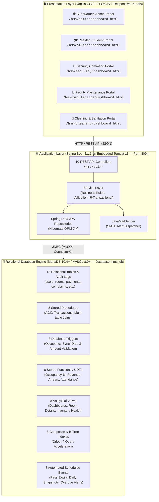

# 🏢 University of Ruhuna — Hostel Management System (HMS)
### 🎓 Advanced Database Management Systems (ADBMS) — Mini Project
#### Faculty of Technology, University of Ruhuna

---

[](https://www.oracle.com/java/)
[](https://spring.io/projects/spring-boot)
[](https://hibernate.org/orm/)
[](https://mariadb.org/)
[](https://gradle.org/)
[](https://developer.mozilla.org/en-US/docs/Web/HTML)
[](http://localhost:8094/hms/login.html)

---

## 📑 Table of Contents
1. [Project Overview](#-project-overview)
2. [Key Features by Role](#-key-features-by-role)
3. [System Architecture](#-system-architecture)
4. [Repository File Structure](#-repository-file-structure)
5. [ADBMS Workload Distribution (48 Database Objects)](#-adbms-workload-distribution-48-database-objects)
6. [Member 1 Contributions — Student Welfare & Residence](#-member-1-contributions--student-welfare--residence)
7. [Member 2 Contributions — Treasury & Logistics](#-member-2-contributions--treasury--logistics)
8. [Database Transactions & ACID Compliance](#-database-transactions--acid-compliance)
9. [Performance Indexes & Triggers Verification](#-performance-indexes--triggers-verification)
10. [REST API Documentation](#-rest-api-documentation)
11. [Default Login Credentials](#-default-login-credentials)
12. [Step-by-Step Setup & Execution Guide](#-step-by-step-setup--execution-guide)
13. [Troubleshooting & FAQs](#-troubleshooting--faqs)
14. [Academic Integrity & Authors](#-academic-integrity--authors)

---

## 📌 Project Overview

The **Hostel Management System (HMS)** is a full-featured, university-level residential and facility governance application built specifically for the **Faculty of Technology, University of Ruhuna**. It digitizes, automates, and connects all student boarding operations across 4 residential blocks (`Block A`, `Block B`, `Block C`, `Block D`).

### 🎯 Core Objectives:
- **Student Residence Lifecycle:** Automated room allocation, bed capacity enforcement (max 4 per room), and multi-table clearance upon checkout.
- **Campus Gate Pass Security:** End-to-end departure pass workflow with multi-level authorization (Student Application $\rightarrow$ Sub Warden Approval $\rightarrow$ Gate Officer Departure/Re-entry logging).
- **Treasury & Fee Management:** Automated invoice generation, payment ledger recording, arrears calculation, and audit trail generation.
- **Facility Repairs & Logistics:** Student complaint lodging, maintenance work-order dispatch, room damaged asset tracking, and warehouse spare parts inventory balance synchronization.
- **Staff Shift Attendance:** Daily duty check-in/check-out tracking for Security, Maintenance, and Cleaning personnel with automatic absence marking.
- **Broadcast Notices & SMTP Alerts:** Live campus announcement board and transactional email dispatch via JavaMailSender.

The project demonstrates advanced database engineering concepts with **48 Advanced Database Objects** evenly divided between two team members (**24 objects per member**), adhering to strict **ACID transactional guarantees**, constraint enforcement, analytical indexing, and background event scheduling.

---

## 🌟 Key Features by Role

```
┌─────────────────────────────────────────────────────────────────────────────┐
│                    🏢 RUHUNA HOSTEL MANAGEMENT SYSTEM                       │
├─────────────────┬─────────────────┬──────────────────┬──────────────────────┤
│ 🛡️ Sub Warden   │ 🎓 Student      │ 👮 Security      │ 🔧 Maintenance &     │
│    (Admin)      │    Portal       │    Command       │ 🧹 Cleaning Staff    │
├─────────────────┼─────────────────┼──────────────────┼──────────────────────┤
│ • Room Mgt      │ • My Room Info  │ • Gate Clearance │ • Damage Repair Log  │
│ • Allocations   │ • Fee Invoices  │ • Real-time Log  │ • Parts Consumption │
│ • Treasury/Fees │ • Gate Pass App │ • Overdue Flags  │ • Ticket Resolution  │
│ • Complaints    │ • File Ticket   │ • Student Lookup │ • Shift Check-in/out │
│ • Staff Roster  │ • Campus Notices│ • Daily Check-in │ • Sanitation Tracker │
│ • Notice Post   │ • PDF Receipts  │ • Curfew Alerts  │ • Personal Summary   │
└─────────────────┴─────────────────┴──────────────────┴──────────────────────┘
```

---

## 🏗️ System Architecture

The system follows an enterprise **Three-Tier Layered Architecture**:



---

## 📁 Repository File Structure

```text
HMS/
├── build.gradle                                    # Gradle build script (Spring Boot 4.1.1, Java 17, JPA, Mail)
├── settings.gradle                                 # Project identifier ('hms')
├── gradlew & gradlew.bat                           # Portable Gradle wrapper scripts
├── README.md                                       # Comprehensive project documentation
├── HELP.md                                         # Gradle & Spring reference links
│
├── src/main/java/com/ruhuna/hms/
│   ├── HmsApplication.java                         # Main entry point & default admin seeding CommandLineRunner
│   ├── controller/                                 # 10 REST API Controllers
│   │   ├── UserController.java                     # /api/users (Accounts, Login, Allocation)
│   │   ├── RoomController.java                     # /api/rooms (Room directory & Bed counts)
│   │   ├── PaymentController.java                  # /api/payments (Fee ledger & Student statements)
│   │   ├── GatePassController.java                 # /api/gatepasses (Leave applications & Approvals)
│   │   ├── ComplaintController.java                # /api/complaints (Defect tickets & Escalations)
│   │   ├── InventoryController.java                # /api/inventory (Central warehouse assets)
│   │   ├── RoomInventoryController.java            # /api/room-inventory (Room-specific damages & repairs)
│   │   ├── StaffAttendanceController.java          # /api/staff-attendance (Duty check-in/out & Roster)
│   │   ├── NoticeController.java                   # /api/notices (Campus announcements bulletin)
│   │   └── EmailController.java                    # /api/email (Transactional email dispatch)
│   ├── dto/                                        # Data Transfer Objects
│   │   ├── LoginRequest.java                       # Authentication payload
│   │   └── ApiResponse.java                        # Standardized JSON response envelope
│   ├── entity/                                     # 9 JPA Relational Entities
│   │   ├── User.java, Room.java, Payment.java, GatePass.java, Complaint.java,
│   │   ├── Inventory.java, RoomInventory.java, StaffAttendance.java, Notice.java
│   │   └── exception/                              # Custom Exception Handlers
│   ├── repository/                                 # 9 Spring Data JPA Interface Repositories
│   └── service/                                    # Service implementations with @Transactional annotations
│
└── src/main/resources/
    ├── application.properties                      # Configuration (Port 8094, Context /hms, DB URL, SMTP)
    │
    ├── adbms_member1_student_welfare.sql           # Member 1 ADBMS Script (24 Advanced Objects)
    ├── adbms_member2_treasury_logistics.sql        # Member 2 ADBMS Script (24 Advanced Objects)
    ├── adbms_transactions_and_stored_procedures.sql# Consolidated ACID Transactions & Stored Procedures (8 SPs)
    ├── adbms_triggers_and_indexes.sql              # Consolidated Triggers (8) & Performance Indexes (8)
    │
    └── static/                                     # Frontend Web Assets & Multi-Role Portals
        ├── index.html & login.html                 # Login page with Dynamic Role Preview & Quick-fill
        ├── css/                                    # Design System (style.css, login.css, modal.css)
        ├── admin/                                  # Sub Warden Administrative Dashboard
        ├── student/                                # Resident Student Portal
        ├── security/                               # Security Gate Clearance Portal
        ├── maintenance/                            # Facility Maintenance & Asset Repair Portal
        └── cleaning/                               # Sanitation & Room Housekeeping Portal
```

---

## 👥 ADBMS Workload Distribution (48 Database Objects)

The project satisfies all Advanced Database Management Systems (ADBMS) criteria by implementing **48 Advanced Database Objects** distributed symmetrically between two members:

| Component Category | Member 1 (Student Welfare & Residence) | Member 2 (Treasury & Logistics) | Total Objects |
| :--- | :---: | :---: | :---: |
| **Stored Procedures** | **4** *(Multi-table operations 3–5 tables)* | **4** *(Multi-table operations 3–4 tables)* | **8** |
| **Database Triggers** | **4** *(Occupancy sync, Date check, Bed limit, Resolution)* | **4** *(Audit trail, Amount validation, Stock check, Remarks)* | **8** |
| **Stored Functions (UDFs)** | **4** *(Occupancy %, Complaints count, Pass status, Block)* | **4** *(Monthly revenue, True stock, Staff days, Arrears)* | **8** |
| **Analytical Views** | **4** *(360° Student, Gate clearance, Complaints, Capacity)* | **4** *(Revenue overview, Inventory health, Damages, Staff)* | **8** |
| **Performance Indexes** | **4** *(Student ID, Room-Role, Gate status, Complaint room)* | **4** *(Payment month, User date, Stock category, Attendance)* | **8** |
| **Scheduled Events** | **4** *(Pass expiry, Daily snapshot, Overdue flag, Escalation)* | **4** *(Billing notice, Absent marker, Restock alert, Log purge)* | **8** |
| **Total Advanced Objects** | **24 Objects** | **24 Objects** | **48 Objects** |

---

## 👤 Member 1 Contributions — Student Welfare & Residence

- **Script Path:** [`src/main/resources/adbms_member1_student_welfare.sql`](file:///d:/Progects%203.2/HMS/src/main/resources/adbms_member1_student_welfare.sql)
- **Domain:** Student Resident Welfare, Room Allocations, Campus Gate Passes, Complaints, and Clearance Management.

### 1. Stored Procedures (4)
1. `sp_AllocateStudentRoom(p_student_id, p_room_number, OUT p_status)`
   - **Tables Involved:** `users`, `rooms`, `payments`, `room_inventory`, `user_audit_log` (5 tables).
   - **Functionality:** Validates that the student exists, verifies target room capacity, confirms that there is no broken critical equipment in the target room, verifies payment record existence, atomically shifts student, updates occupancy counters, and records the allocation in `user_audit_log`.
2. `sp_DeallocateStudentRoom(p_student_id, OUT p_status)`
   - **Tables Involved:** `users`, `rooms`, `complaints`, `user_audit_log` (4 tables).
   - **Functionality:** Performs hostel checkout clearance. Confirms that student has no unresolved damage complaints, frees the bed space, decrements room occupancy, and records checkout clearance.
3. `sp_ProcessGatePassApproval(p_pass_id, p_decision, p_reviewer, OUT p_result)`
   - **Tables Involved:** `gate_passes`, `users`, `user_audit_log` (3 tables).
   - **Functionality:** Processes leave pass approval/rejection, verifies student status, applies timestamp, and logs reviewer identity.
4. `sp_FileStudentComplaint(p_student_id, p_room_number, p_item, p_description, OUT p_complaint_id)`
   - **Tables Involved:** `users`, `complaints`, `inventory`, `user_audit_log` (4 tables).
   - **Functionality:** Files an official maintenance ticket, checks whether the reported item is a registered warehouse asset, and creates an audit entry.

### 2. Database Triggers (4)
1. `trg_AfterUserRoomChange` (`AFTER UPDATE ON users`)
   - Auto-synchronizes `rooms.current_occupancy` whenever `users.room_id` is updated (handles new allocation, deallocation, and inter-room transfers).
2. `trg_BeforeGatePassInsert` (`BEFORE INSERT ON gate_passes`)
   - Enforces temporal integrity: verifies `to_date >= from_date`. Throws `SQLSTATE '45000'` with descriptive error message if violated.
3. `trg_PreventExceedRoomCapacity` (`BEFORE UPDATE ON rooms`)
   - Prevents overbooking: aborts the update if `NEW.current_occupancy > NEW.capacity`.
4. `trg_AfterComplaintResolvedLog` (`AFTER UPDATE ON complaints`)
   - Triggers when complaint transitions to `RESOLVED`, writing resolution timestamp and ticket metadata to `user_audit_log`.

### 3. Stored Functions / UDFs (4)
1. `fn_GetRoomOccupancyRate(p_room_id)` $\rightarrow$ `DECIMAL(5,2)`
   - Joins `rooms` and `users` to calculate and return exact room occupancy percentage.
2. `fn_GetStudentTotalComplaints(p_user_id)` $\rightarrow$ `INT`
   - Returns the cumulative count of complaints logged by a specific student.
3. `fn_CheckStudentGatePassStatus(p_user_id)` $\rightarrow$ `VARCHAR(50)`
   - Joins `gate_passes` and returns student status (`ON_OFFICIAL_LEAVE`, `OVERDUE_RETURN`, `IN_HOSTEL`).
4. `fn_GetRoomBlockFloor(p_room_number)` $\rightarrow$ `VARCHAR(100)`
   - String parsing function that extracts block name and floor level from formatted room strings (e.g., `"A-102"` $\rightarrow$ `"Block A, Floor 1"`).

### 4. Analytical Views (4)
1. `vw_StudentRoomDetails`
   - 360° resident overview joining `users`, `rooms`, `payments`, and `complaints`.
2. `vw_ActiveGatePasses`
   - Real-time gate clearance dashboard for security personnel joining `gate_passes`, `users`, and `rooms`.
3. `vw_PendingComplaintsDashboard`
   - Maintenance command dashboard joining unresolved tickets with room locations and warehouse parts availability.
4. `vw_RoomOccupancyOverview`
   - Block-by-block occupancy summary calculating occupied beds, total capacities, and vacancy rates.

### 5. Performance Indexes (4)
1. `idx_users_student_id` on `users(student_id)`
   - Accelerates student login queries, TG number searches, and identity lookups from $O(n)$ to $O(\log n)$.
2. `idx_users_room_role` on `users(room_id, role)`
   - Speeds up roommate lookups, block occupancy aggregation, and student listing queries.
3. `idx_gate_passes_user_status` on `gate_passes(user_id, status)`
   - Optimizes student pass history lookups and security gate verification checks.
4. `idx_complaints_status_room` on `complaints(status, room_number)`
   - Accelerates ticket filtering by room number and status on administrative dashboards.

### 6. Scheduled Events (4)
1. `evt_AutoExpireOldGatePasses` *(Runs Daily)*
   - Automatically sets pending gate passes to `EXPIRED` if the requested departure date has elapsed without warden review.
2. `evt_DailyRoomOccupancySnapshot` *(Runs Daily at 23:59)*
   - Takes daily census snapshots of occupied beds vs total capacity per block and saves into `hostel_daily_stats`.
3. `evt_FlagOverdueResidents` *(Runs Every 6 Hours)*
   - Automatically transitions approved passes to `OVERDUE_RETURN` for students who failed to check back in past their return date.
4. `evt_AutoEscalatePendingComplaints` *(Runs Daily)*
   - Scans for complaints unresolved for $> 4$ days and writes an escalation record in `user_audit_log` addressed to the Sub Warden.

---

## 👤 Member 2 Contributions — Treasury & Logistics

- **Script Path:** [`src/main/resources/adbms_member2_treasury_logistics.sql`](file:///d:/Progects%203.2/HMS/src/main/resources/adbms_member2_treasury_logistics.sql)
- **Domain:** Hostel Treasury, Monthly Fee Invoicing, Warehouse Inventory Logistics, Asset Repairs, and Staff Attendance.

### 1. Stored Procedures (4)
1. `sp_RecordStudentPayment(p_student_id, p_month, p_amount, OUT p_invoice_no)`
   - **Tables Involved:** `users`, `rooms`, `payments`, `payment_audit_log` (4 tables).
   - **Functionality:** Verifies student existence, validates positive fee amount, checks that fees for the month have not already been settled, issues an invoice number, and writes an entry into `payment_audit_log`.
2. `sp_ReportRoomDamage(p_room_number, p_item_name, p_broken_qty, p_description, OUT p_damage_id)`
   - **Tables Involved:** `rooms`, `inventory`, `room_inventory`, `complaints` (4 tables).
   - **Functionality:** Logs broken equipment inside a room, decrements warehouse available stock, and cross-links student complaint tickets.
3. `sp_CompleteRoomRepair(p_damage_id, OUT p_status)`
   - **Tables Involved:** `room_inventory`, `inventory`, `complaints` (3 tables).
   - **Functionality:** Marks repair complete, replenishes warehouse operational stock, and automatically resolves corresponding complaints.
4. `sp_RecordStaffCheckIn(p_staff_id, p_marked_by, OUT p_status)`
   - **Tables Involved:** `users`, `staff_attendance`, `user_audit_log` (3 tables).
   - **Functionality:** Records staff duty check-in timestamp with department role verification.

### 2. Database Triggers (4)
1. `trg_AfterPaymentInsertAudit` (`AFTER INSERT ON payments`)
   - Writes payment transactions to `payment_audit_log` with student ID, generated invoice number, and timestamp.
2. `trg_BeforePaymentValidateAmount` (`BEFORE INSERT ON payments`)
   - Enforces financial constraint: rejects payments with `amount <= 0` using `SIGNAL SQLSTATE '45000'`.
3. `trg_BeforeInventoryStockUpdate` (`BEFORE UPDATE ON inventory`)
   - Enforces inventory equation: ensures `available_quantity <= total_quantity`.
4. `trg_BeforeStaffCheckOutUpdate` (`BEFORE UPDATE ON staff_attendance`)
   - Automatically populates check-out remarks and verifies check-out timestamp validity.

### 3. Stored Functions / UDFs (4)
1. `fn_CalculateMonthlyTotalRevenue(p_month)` $\rightarrow$ `DECIMAL(12,2)`
   - Calculates the verified fee revenue collected for a specified calendar month.
2. `fn_GetItemAvailableStock(p_item_id)` $\rightarrow$ `INT`
   - Calculates true operational warehouse stock subtracting broken room assets.
3. `fn_GetStaffMonthlyPresentDays(p_user_id, p_year, p_month)` $\rightarrow$ `INT`
   - Aggregates the total present shift count for a staff member during a specified month for payroll audit.
4. `fn_CalculateStudentFeeArrears(p_user_id)` $\rightarrow$ `DECIMAL(10,2)`
   - Computes student outstanding hostel boarding arrears (expected fee schedule minus actual paid).

### 4. Analytical Views (4)
1. `vw_MonthlyRevenueSummary`
   - Monthly treasury overview displaying collected revenue, paid invoice counts, and average transaction amount.
2. `vw_InventoryHealthStatus`
   - Warehouse stock levels, broken item counts in rooms, and stockout condition indicators.
3. `vw_RoomDamagesTracker`
   - Active equipment damages linked to room location, resident students, and replacement inventory availability.
4. `vw_StaffDutyAttendanceSummary`
   - Supervisor dashboard displaying total shifts worked, attendance percentage, and last active duty date.

### 5. Performance Indexes (4)
1. `idx_payments_month_status` on `payments(month, status)`
   - Accelerates monthly revenue and fee collection reports.
2. `idx_payments_user_date` on `payments(user_id, payment_date)`
   - Speeds up student fee history lookups and statement generation.
3. `idx_inventory_category_avail` on `inventory(category, available_quantity)`
   - Accelerates warehouse inventory filtering and stock availability queries.
4. `idx_staff_att_user_date` on `staff_attendance(user_id, date, status)`
   - Accelerates staff duty roster audits and daily shift verification queries.

### 6. Scheduled Events (4)
1. `evt_MonthlyFeeBillingReminder` *(Runs 1st of every month)*
   - Posts an official boarding fee payment reminder notice into the `notices` table.
2. `evt_DailyStaffAbsenceMarker` *(Runs Daily at 18:30)*
   - Identifies non-checked-in staff and logs an automatic `ABSENT` shift entry.
3. `evt_WeeklyInventoryRestockAlert` *(Runs Weekly)*
   - Scans warehouse inventory and writes warnings to `inventory_alert_log` for any asset where `available_quantity < 5`.
4. `evt_PurgeOldAuditLogs` *(Runs Monthly)*
   - Performs database housekeeping by pruning audit log records older than 180 days.

---

## 🔒 Database Transactions & ACID Compliance

All **8 Stored Procedures** in this project are built with full **ACID Transaction Control**:

```
┌─────────────────────────────────────────────────────────────────────────────┐
│                       ACID COMPLIANCE ARCHITECTURE                          │
├─────────────────┬───────────────────────────────────────────────────────────┤
│ Atomicity       │ START TRANSACTION ... COMMIT; guarantees all table updates│
│                 │ succeed together or none execute.                         │
├─────────────────┼───────────────────────────────────────────────────────────┤
│ Consistency     │ DECLARE EXIT HANDLER FOR SQLEXCEPTION ensures automatic   │
│                 │ ROLLBACK; maintaining strict foreign keys and triggers.   │
├─────────────────┼───────────────────────────────────────────────────────────┤
│ Isolation       │ Repeatable Read isolation level prevents dirty reads and  │
│                 │ concurrent room overbooking.                             │
├─────────────────┼───────────────────────────────────────────────────────────┤
│ Durability      │ Changes committed to disk via MariaDB InnoDB engine.      │
└─────────────────┴───────────────────────────────────────────────────────────┘
```

- **Consolidated Transactions Script:** [`src/main/resources/adbms_transactions_and_stored_procedures.sql`](file:///d:/Progects%203.2/HMS/src/main/resources/adbms_transactions_and_stored_procedures.sql)

### Verification in MySQL / phpMyAdmin:
```sql
-- 1. Test Payment Transaction (Atomically creates payment + audit record)
CALL sp_RecordStudentPayment('TG/2021/0001', 'November 2026', 1500.00, @inv);
SELECT @inv AS generated_invoice;
SELECT * FROM payment_audit_log ORDER BY id DESC LIMIT 1;

-- 2. Test Room Allocation Transaction (Atomically updates users, rooms, and audit log)
CALL sp_AllocateStudentRoom('TG/2021/0001', 'A-102', @alloc_status);
SELECT @alloc_status AS allocation_status;
SELECT * FROM user_audit_log ORDER BY id DESC LIMIT 1;
```

---

## ⚡ Performance Indexes & Triggers Verification

- **Consolidated Triggers & Indexes Script:** [`src/main/resources/adbms_triggers_and_indexes.sql`](file:///d:/Progects%203.2/HMS/src/main/resources/adbms_triggers_and_indexes.sql)

### Inspect Triggers & Indexes:
```sql
-- View all 8 Database Triggers:
SHOW TRIGGERS;

-- View all 8 Performance Indexes:
SELECT TABLE_NAME, INDEX_NAME, GROUP_CONCAT(COLUMN_NAME) AS COLUMNS
FROM information_schema.STATISTICS 
WHERE TABLE_SCHEMA = 'hms_db' AND INDEX_NAME LIKE 'idx_%'
GROUP BY TABLE_NAME, INDEX_NAME;

-- Verify Event Scheduler Status:
SHOW VARIABLES LIKE 'event_scheduler';
-- Ensure events are enabled:
SET GLOBAL event_scheduler = ON;
```

---

## 🌐 REST API Documentation

The Spring Boot backend exposes **10 REST Controllers** under the base context path `/hms`:

| Controller | HTTP Method | Endpoint | Description |
| :--- | :---: | :--- | :--- |
| **`UserController`** | `GET` | `/hms/api/users` | Retrieve all registered users across all roles |
| | `POST` | `/hms/api/users` | Register a new user account |
| | `PUT` | `/hms/api/users/{userId}/allocate/{roomId}` | Allocate a resident student to a hostel room |
| | `POST` | `/hms/api/users/login` | Authenticate credentials and return user profile |
| **`RoomController`** | `GET` | `/hms/api/rooms` | Retrieve all rooms across Blocks A, B, C, D |
| | `POST` | `/hms/api/rooms` | Register a new room and configure bed capacity |
| **`PaymentController`** | `GET` | `/hms/api/payments` | Retrieve full hostel fee ledger |
| | `GET` | `/hms/api/payments/user/{userId}` | Retrieve payment history for a specific student |
| | `POST` | `/hms/api/payments` | Process new fee payment & issue invoice |
| | `PUT` | `/hms/api/payments/{id}` | Update payment record |
| | `DELETE` | `/hms/api/payments/{id}` | Delete payment record |
| **`GatePassController`** | `GET` | `/hms/api/gatepasses` | Retrieve all gate passes |
| | `GET` | `/hms/api/gatepasses/user/{userId}` | Retrieve gate pass history for a specific student |
| | `POST` | `/hms/api/gatepasses` | Submit new gate pass request (`PENDING`) |
| | `PUT` | `/hms/api/gatepasses/{id}/approve` | Sub Warden approval (`APPROVED`) |
| | `PUT` | `/hms/api/gatepasses/{id}/reject` | Sub Warden rejection (`REJECTED`) |
| | `PUT` | `/hms/api/gatepasses/{id}/depart` | Gate officer marks student departed (`DEPARTED`) |
| **`ComplaintController`** | `GET` | `/hms/api/complaints` | Retrieve all complaint tickets |
| | `GET` | `/hms/api/complaints/user/{userId}` | Retrieve complaints submitted by specific student |
| | `POST` | `/hms/api/complaints` | Submit new defect complaint |
| | `PUT` | `/hms/api/complaints/{id}/resolve` | Mark ticket as `RESOLVED` |
| | `PUT` | `/hms/api/complaints/{id}/notify-maintenance` | Dispatch ticket to technician with priority & due date |
| | `PUT` | `/hms/api/complaints/{id}/escalate` | Escalate overdue ticket |
| **`InventoryController`** | `GET` | `/hms/api/inventory` | Retrieve warehouse asset catalog & stock balances |
| | `POST` | `/hms/api/inventory` | Add item or update stock |
| **`RoomInventoryController`** | `GET` | `/hms/api/room-inventory` | Retrieve all room-specific equipment damage reports |
| | `GET` | `/hms/api/room-inventory/room/{roomId}` | Retrieve damages for a specific room |
| | `POST` | `/hms/api/room-inventory` | Report damaged room equipment |
| | `PUT` | `/hms/api/room-inventory/{id}/status` | Update repair status |
| | `PUT` | `/hms/api/room-inventory/{id}/repair` | Mark item repaired (`REPAIRED`) |
| | `DELETE` | `/hms/api/room-inventory/{id}` | Delete damage record |
| **`StaffAttendanceController`** | `GET` | `/hms/api/staff-attendance` | Retrieve all staff duty logs |
| | `GET` | `/hms/api/staff-attendance/staff/{staffId}` | Retrieve duty logs for specific staff member |
| | `GET` | `/hms/api/staff-attendance/staff/{staffId}/summary` | Retrieve KPI summary (days present, shifts, rate) |
| | `POST` | `/hms/api/staff-attendance/checkin/{staffId}` | Clock-in for daily duty |
| | `POST` | `/hms/api/staff-attendance/checkout/{staffId}` | Clock-out from daily duty |
| | `POST` | `/hms/api/staff-attendance/admin-mark` | Supervisor manually marks attendance/absence |
| **`NoticeController`** | `GET` | `/hms/api/notices` | Retrieve all official broadcast circulars |
| | `POST` | `/hms/api/notices` | Post a new official administrative circular |
| **`EmailController`** | `POST` | `/hms/api/email/send` | Transmit transactional email via SMTP |

---

## 🔑 Default Login Credentials

The login page (`/hms/login.html`) features **Quick-Role Buttons** that automatically populate credentials and adjust the background theme to match each role:

| Role | Username / ID | Password | Target Dashboard | Description |
| :--- | :--- | :--- | :--- | :--- |
| **Sub Warden (Admin)** | `admin` | `admin123` | `/hms/admin/dashboard.html` | Full administrative control, room assignments, treasury, passes, complaints, notices |
| **Resident Student** | `TG/2021/0001` | `password123` | `/hms/student/dashboard.html` | Room status, fee payment statement, leave applications, lodging complaints |
| **Security Command** | `SEC001` *(or `security`)* | `security123` | `/hms/security/dashboard.html` | Gate clearances, student departure/return logs, attendance clock-in |
| **Maintenance Staff** | `MNT001` *(or `maintenance`)* | `maintenance123` | `/hms/maintenance/dashboard.html` | Facility repairs, room damaged asset restoration, ticket resolution |
| **Cleaning Staff** | `CLN001` *(or `cleaning`)* | `cleaning123` | `/hms/cleaning/dashboard.html` | Room cleanliness status, sanitization inspection logs, shift check-in/out |

> [!NOTE]
> The default administrator account (`admin` / `admin123`) is **automatically seeded** by Spring Boot upon the first application startup via [`HmsApplication.java`](file:///d:/Progects%203.2/HMS/src/main/java/com/ruhuna/hms/HmsApplication.java).

---

## 🚀 Step-by-Step Setup & Execution Guide

### 1. Prerequisites
- **Java Development Kit (JDK):** Version 17 or higher
- **Database Server:** MariaDB 10.4+ or MySQL 8.0+ (via XAMPP, WampServer, or standalone)
- **Port Requirements:** Port `3306` (Database) and Port `8094` (Application Server)

---

### 2. Database Creation
1. Start **Apache** and **MySQL** services in the **XAMPP Control Panel**.
2. Open phpMyAdmin at **`http://localhost/phpmyadmin`** (or MySQL CLI).
3. Create an empty database named `hms_db`:
   ```sql
   CREATE DATABASE IF NOT EXISTS hms_db CHARACTER SET utf8mb4 COLLATE utf8mb4_unicode_ci;
   ```

---

### 3. Application Configuration
Verify your database connection settings in [`src/main/resources/application.properties`](file:///d:/Progects%203.2/HMS/src/main/resources/application.properties):

```properties
# Tomcat Web Server
server.port=8094
server.servlet.context-path=/hms

# MySQL / MariaDB Connection
spring.datasource.url=jdbc:mysql://localhost:3306/hms_db?createDatabaseIfNotExist=true&useSSL=false&serverTimezone=UTC
spring.datasource.username=root
spring.datasource.password=

# Hibernate DDL Auto & Dialect
spring.jpa.hibernate.ddl-auto=update
spring.jpa.show-sql=true
spring.jpa.properties.hibernate.dialect=org.hibernate.dialect.MySQLDialect

# Transactional Email (Optional SMTP setup)
spring.mail.host=smtp.gmail.com
spring.mail.port=587
spring.mail.username=your_email@gmail.com
spring.mail.password=your_app_password
spring.mail.properties.mail.smtp.auth=true
spring.mail.properties.mail.smtp.starttls.enable=true
```

---

### 4. Running the Application (First Boot)

Open a terminal or PowerShell in the project root directory:

```bash
# On Windows (PowerShell / Command Prompt):
.\gradlew bootRun

# On Linux / macOS:
./gradlew bootRun
```

> [!IMPORTANT]
> **Why start the app first?**  
> Thanks to `spring.jpa.hibernate.ddl-auto=update`, starting the application automatically creates the 9 primary entity tables (`users`, `rooms`, `payments`, `complaints`, `gate_passes`, `inventory`, `room_inventory`, `staff_attendance`, `notices`) and bootstraps the default administrator account (`admin` / `admin123`).

---

### 5. Importing the ADBMS Advanced Database Scripts

Once the base tables are generated, open **phpMyAdmin** (`http://localhost/phpmyadmin`), select the `hms_db` database, go to the **SQL** tab (or **Import** tab), and execute the scripts in order:

1. [`src/main/resources/adbms_member1_student_welfare.sql`](file:///d:/Progects%203.2/HMS/src/main/resources/adbms_member1_student_welfare.sql)  
   *(Creates Member 1's 4 Stored Procedures, 4 Triggers, 4 Functions, 4 Views, 4 Indexes, 4 Scheduled Events, and audit tables)*
2. [`src/main/resources/adbms_member2_treasury_logistics.sql`](file:///d:/Progects%203.2/HMS/src/main/resources/adbms_member2_treasury_logistics.sql)  
   *(Creates Member 2's 4 Stored Procedures, 4 Triggers, 4 Functions, 4 Views, 4 Indexes, 4 Scheduled Events, and alert tables)*

*(Alternatively, you can run the unified scripts: [`adbms_triggers_and_indexes.sql`](file:///d:/Progects%203.2/HMS/src/main/resources/adbms_triggers_and_indexes.sql) and [`adbms_transactions_and_stored_procedures.sql`](file:///d:/Progects%203.2/HMS/src/main/resources/adbms_transactions_and_stored_procedures.sql)).*

Enable the MySQL/MariaDB background Event Scheduler:
```sql
SET GLOBAL event_scheduler = ON;
```

---

### 6. Accessing the Application

Open your browser and navigate to:

👉 **`http://localhost:8094/hms/login.html`** *(or `http://localhost:8094/hms/index.html`)*

Click any of the **Quick Role Preview** buttons (Sub Warden, Student, Security, Maintenance, Cleaning) to instantly fill credentials and explore the corresponding portal!

---

## ❓ Troubleshooting & FAQs

### 1. `Table 'hms_db.users' doesn't exist` when importing SQL scripts
- **Cause:** You ran the SQL scripts before Spring Boot generated the base JPA tables.
- **Solution:** Run `./gradlew bootRun` first so Hibernate creates all core tables. Then import the SQL scripts in phpMyAdmin.

### 2. `Port 8094 is already in use`
- **Cause:** Another instance of HMS or background process is running on port 8094.
- **Solution (PowerShell):**
  ```powershell
  # Find PID using port 8094
  netstat -ano | findstr :8094
  # Terminate process (replace <PID> with number from previous command)
  taskkill /PID <PID> /F
  ```

### 3. MariaDB / MySQL Event Scheduler is not firing
- **Solution:** Ensure the global scheduler is turned on:
  ```sql
  SET GLOBAL event_scheduler = ON;
  SHOW PROCESSLIST;
  ```

### 4. Email notifications fail
- **Solution:** If using Gmail SMTP, generate an **App Password** from Google Account Security $\rightarrow$ 2-Step Verification $\rightarrow$ App Passwords, and place it in `application.properties`.

---

## 📜 Academic Integrity & Authors

This project is submitted in partial fulfillment of the academic requirements for the **Advanced Database Management Systems (ADBMS)** course module at the:

**Department of Information and Communication Technology**  
**Faculty of Technology**  
**University of Ruhuna, Sri Lanka**

| Role | Domain Scope | Responsibility |
| :--- | :--- | :--- |
| **Member 1** | Student Welfare, Rooms, Gate Passes, Complaints | 24 Advanced Database Objects + Welfare Controller APIs |
| **Member 2** | Treasury, Invoicing, Warehouse Logistics, Staff Attendance | 24 Advanced Database Objects + Treasury Controller APIs |

---

<div align="center">
  <b>Designed with ❤️ for University of Ruhuna — Faculty of Technology</b><br/>
  <sub>© 2026 Hostel Management System (HMS). All Rights Reserved.</sub>
</div>
