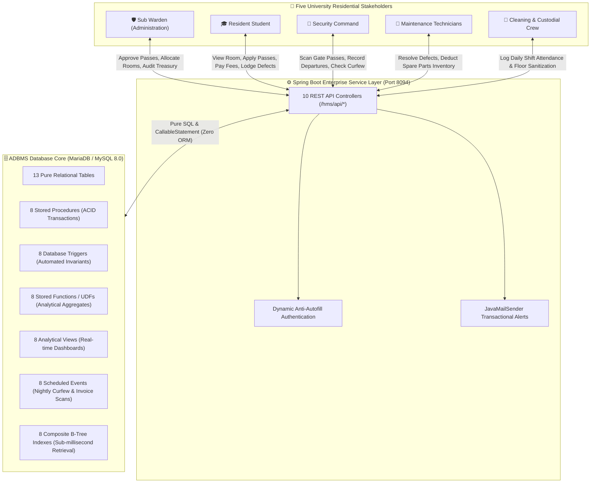
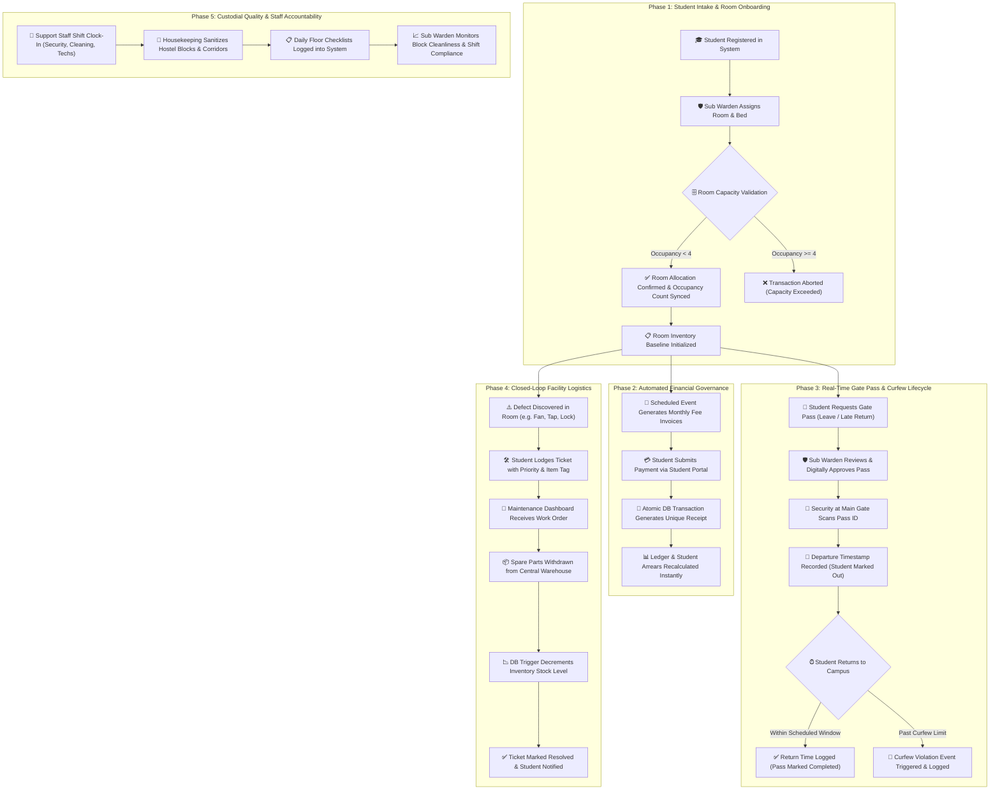
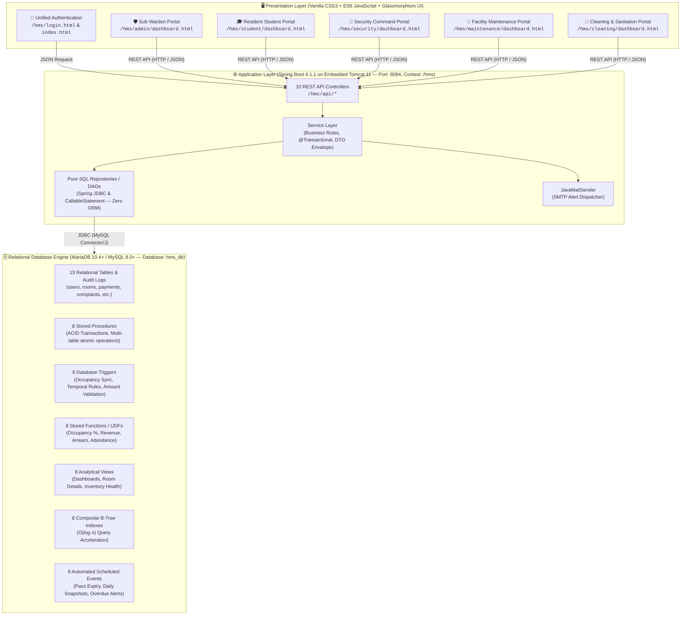
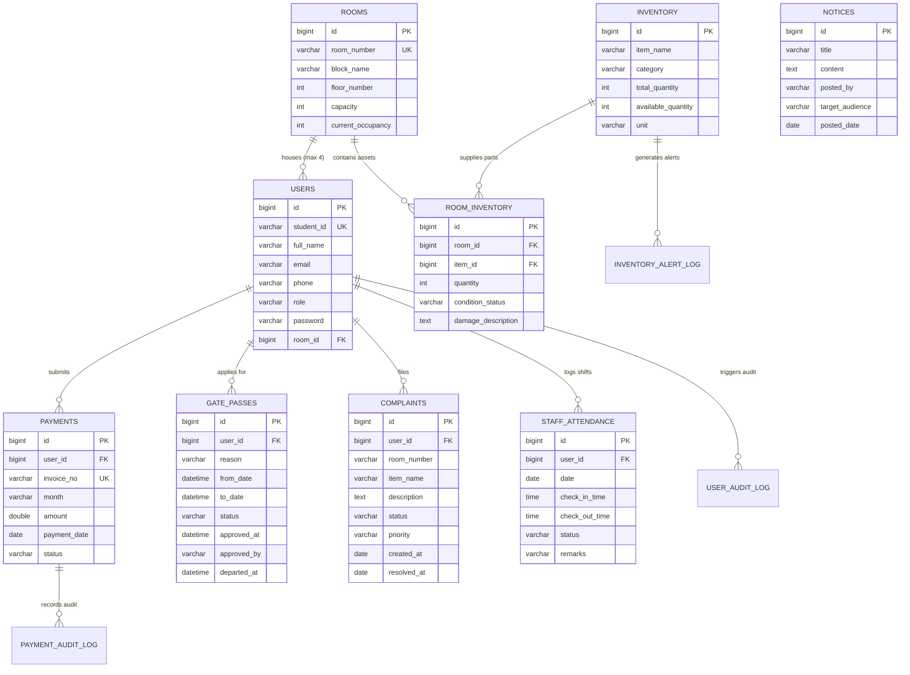
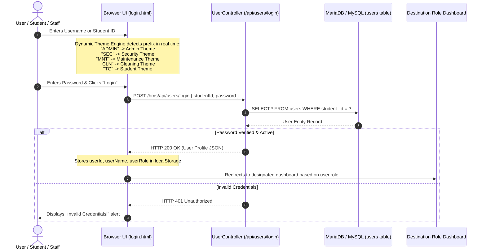

# 🏢 University of Ruhuna — Hostel Management System (HMS)
### 🎓 Advanced Database Management Systems (ADBMS) — Mini Project
#### Department of Information and Communication Technology, Faculty of Technology, University of Ruhuna

--

[](https://www.oracle.com/java/)
[](https://spring.io/projects/spring-boot)
[-00758F?style=for-the-badge&logo=mysql&logoColor=white)](https://spring.io/projects/spring-framework)
[](https://mariadb.org/)
[](https://gradle.org/)
[](https://developer.mozilla.org/en-US/docs/Web/HTML)
[](http://localhost:8094/hms/login.html)
[](http://localhost:8094/hms)
[](http://localhost:8094/hms/login.html)

--

## 📑 Table of Contents
1. [Project Overview](#-project-overview)
2. [Overall System Concept & Big Picture Idea](#-overall-system-concept--big-picture-idea)
   - [The Core Vision & Problem Statement](#-1-the-core-vision--problem-statement)
   - [The 360° Unified Hostel Ecosystem](#-2-the-360-unified-hostel-ecosystem)
   - [End-to-End Operational Lifecycle](#-3-end-to-end-operational-lifecycle)
   - [The "Database-First" Engineering Philosophy](#-4-the-database-first-engineering-philosophy)
   - [Strategic Value Pillars & Impact](#-5-strategic-value-pillars)
3. [Multi-Role System Portals](#-multi-role-system-portals)
4. [System Architecture & Data Modeling](#-system-architecture--data-modeling)
   - [Three-Tier Enterprise Architecture](#-three-tier-enterprise-architecture)
   - [Entity Relationship Diagram (ERD)](#-entity-relationship-diagram-erd)
   - [Dynamic Authentication & Security Architecture](#-dynamic-authentication--security-architecture)
5. [Repository File Hierarchy](#-repository-file-hierarchy)
6. [ADBMS Workload Distribution (48 Database Objects)](#-adbms-workload-distribution-48-database-objects)
   - [Member 1 Contributions — Student Welfare & Residence (24 Objects)](#-member-1-contributions--student-welfare--residence-24-objects)
   - [Member 2 Contributions — Treasury & Logistics (24 Objects)](#-member-2-contributions--treasury--logistics-24-objects)
7. [Database Transactions & ACID Compliance Architecture](#-database-transactions--acid-compliance-architecture)
8. [Comprehensive REST API Reference (10 Controllers)](#-comprehensive-rest-api-reference-10-controllers)
9. [Default Login Credentials](#-default-login-credentials)
10. [Step-by-Step Setup & Execution Guide](#-step-by-step-setup--execution-guide)
11. [Troubleshooting & FAQs](#-troubleshooting--faqs)
12. [Academic Integrity & Authors](#-academic-integrity--authors)

---

## 📌 Project Overview

The **Hostel Management System (HMS)** is an enterprise-grade university residential and facility governance platform developed for the **Faculty of Technology, University of Ruhuna**. It streamlines and automates all student residential operations across four main hostel accommodation blocks (**Block A**, **Block B**, **Block C**, and **Block D**).

### 🎯 Key Engineering Goals:
- **Student Boarding Lifecycle:** Automated room allocation, strict room capacity validation ($\le 4$ students per room), roommate assignments, and clearance deallocation.
- **Campus Gate Pass Security Clearance:** End-to-end leave application workflow featuring multi-stage authorization (Student Request $\rightarrow$ Sub Warden Review $\rightarrow$ Security Gate Departure / Re-entry Logging with Curfew Alerts).
- **Hostel Treasury & Fee Management:** Automated monthly fee invoicing, receipt generation, financial ledger accounting, arrears calculations, and payment audit tracking.
- **Facility Maintenance & Warehouse Logistics:** Complaint ticket ticketing, defect escalations, damaged room asset tracking, and central warehouse spare parts stock balance synchronization.
- **Staff Duty & Shift Attendance:** Check-in/check-out tracking for Security, Maintenance, and Cleaning personnel with automatic absence logging.
- **Broadcast Notices & SMTP Alerts:** Official campus announcement board and transactional email dispatch via `JavaMailSender`.
- **Advanced Database Management Systems (ADBMS) Excellence:** Implements **48 Advanced Database Objects** symmetrically divided between two project members (**24 objects per member**), incorporating **ACID-compliant Stored Procedures**, **Triggers**, **Stored Functions (UDFs)**, **Analytical Views**, **Composite B-Tree Indexes**, and **Automated Scheduled Events**.

---

## 💡 Overall System Concept & Big Picture Idea

The **Hostel Management System (HMS)** was conceived and engineered as a modern, digital-first residential governance infrastructure for the **Faculty of Technology, University of Ruhuna**. It reimagines university accommodation not merely as room-and-bed booking, but as an interconnected ecosystem encompassing **student safety, financial governance, campus mobility, infrastructure maintenance, and custodial hygiene**.

---

### 🎯 1. The Core Vision & Problem Statement

In large-scale collegiate boarding environments housing hundreds of students across multiple multi-story hostels (**Block A**, **Block B**, **Block C**, and **Block D**), traditional administrative methods rely on physical paperwork, fragmented ledgers, and siloed communication:
- **Paper Logbooks & Delayed Allocations:** Room allocations recorded on paper ledgers risk double-booking, over-capacity violations, and lack real-time visibility into bed availability.
- **Vulnerable Gate Pass Clearance:** Physical paper slips signed by wardens and checked manually at security gates often get lost, lack verification, and fail to provide real-time alerts when students breach night curfews.
- **Revenue Leakage & Audit Blind Spots:** Manual fee collection and paper invoicing cause delayed student fee tracking, untracked payment backlogs, and tedious manual reconciliation.
- **Uncoordinated Maintenance & Asset Depreciation:** Broken fixtures (lighting, fans, plumbing, study tables) reported verbally or on note pads lead to prolonged downtime, untracked inventory consumption from the central store, and unverified damage accountability.
- **Unmonitored Custodial Standards:** Lack of structured daily sanitization audits across corridors, washrooms, and study halls compromises hygiene standards.

> [!IMPORTANT]
> **The Paradigm Shift:** HMS bridges every operational domain into a **single, paperless, real-time platform**. Every stakeholder interacts with a tailored interface backed by a unified database, ensuring absolute operational transparency, student safety, and institutional accountability.

---

### 🌐 2. The 360° Unified Hostel Ecosystem

The system synchronizes five vital university residential stakeholder groups into a unified digital workflow:



---

### 🔄 3. End-to-End Operational Lifecycle

The system orchestrates the complete student boarding lifecycle from initial check-in to final exit, linking security, maintenance, and finance at each phase:



---

### 🏛️ 4. The "Database-First" Engineering Philosophy

Most conventional web applications implement business logic predominantly in the application layer (Java, Node.js, Python), treating the relational database simply as a passive storage medium. This introduces risks of race conditions, inconsistent data across concurrent requests, and latency under high loads.

HMS adopts an **Advanced Database Management Systems (ADBMS) Philosophy**:
1. **Zero-ORM Raw SQL Architecture:** The backend uses pure Spring JDBC (`JdbcTemplate` and `CallableStatement`) with zero ORM overhead (no Hibernate/JPA entity caching or N+1 query pitfalls). Queries execute at bare-metal database speeds.
2. **Business Rule Enforcement at Engine Level:** Invariants are locked into the database schema:
   - **Stored Procedures:** Execute atomic, multi-table business operations wrapped in strict ACID transactions (e.g., room allocation, gate checkout, inventory consumption).
   - **Database Triggers:** Intercept inserts and updates to enforce rules autonomously (e.g., preventing room over-occupancy past 4 students, validating that gate passes cannot be backdated, syncing inventory levels).
   - **User-Defined Functions (UDFs):** Compute aggregate metrics directly inside query execution (e.g., hostel occupancy percentages, total monthly collected revenue, per-student outstanding arrears).
   - **Automated Scheduled Events:** Run internal database cron jobs to auto-expire stale gate passes, flag curfew violations, and generate daily operational snapshots without requiring external operating system crontabs.
   - **Composite B-Tree Indexes:** Accelerate frequent lookup paths ($O(\log n)$), ensuring millisecond response times even under thousands of concurrent audit log entries.

---

### 💎 5. Strategic Value Pillars

| Pillar | Operational Problem Solved | HMS Strategic Impact |
| :--- | :--- | :--- |
| **🛡️ Student Safety & Perimeter Security** | Unverified departures, lost paper passes, untracked late-night returns | Real-time digital gate verification, gate timestamps, automated curfew violation alerts, and instant warden escalation. |
| **💰 Financial Transparency & Zero Leakage** | Missing fee receipts, delayed reconciliation, untracked student arrears | Automated invoice generation, atomic payment transactions, instant digital receipts, and real-time ledger auditing. |
| **📦 Asset Protection & Closed-Loop Logistics** | Damaged university fixtures, unreported repairs, spare parts inventory shrinkage | Room-level asset mapping, damage accountability, synchronized warehouse stock deduction, and real-time low-stock alerts. |
| **⚡ Rapid Operational Dispatch** | Administrative delays caused by physical signatures and manual paperwork | Five specialized portals allowing instant digital handoffs between students, wardens, guards, technicians, and cleaners. |
| **🌱 Paperless Campus Sustainability** | Hundreds of reams of paper wasted yearly on pass slips, payment vouchers, and complaint logs | 100% digital, cloud-ready, responsive glassmorphic interfaces accessible across desktop, tablet, and mobile devices. |

---

## 🌟 Multi-Role System Portals

The application provides dedicated web interfaces tailored to five distinct operational roles:

```
┌─────────────────────────────────────────────────────────────────────────────────────────────┐
│                            🏢 RUHUNA HOSTEL MANAGEMENT SYSTEM                               │
├─────────────────┬──────────────────┬─────────────────┬─────────────────┬────────────────────┤
│ 🛡️ Sub Warden   │ 🎓 Resident      │ 👮 Security     │ 🔧 Maintenance  │ 🧹 Cleaning &      │
│    (Admin)      │    Student       │    Command      │    Technicians  │    Sanitation      │
├─────────────────┼──────────────────┼─────────────────┼─────────────────┼────────────────────┤
│ • Room Directory│ • Bed Info & Room│ • Pass Scanner  │ • Ticket Queue  │ • Floor Checklist  │
│ • Allocations   │ • Fee Ledger     │ • Departure Log │ • Room Damages  │ • Sanitization Log │
│ • Treasury Mgt  │ • Gate Pass App  │ • Curfew Alerts │ • Part Restock  │ • Shift Clock-in   │
│ • Ticket Review │ • Lodge Defect   │ • Shift Clock-in│ • Shift Clock-in│ • Shift Clock-out  │
│ • Staff Roster  │ • Notices Board  │ • Overdue Flags │ • Resolution Log│ • Cleanliness View │
│ • Issue Notices │ • PDF Receipts   │ • Quick Verify  │ • Inventory View│ • Daily Status     │
└─────────────────┴──────────────────┴─────────────────┴─────────────────┴────────────────────┘
```

| Portal | Target URL | Primary Responsibilities |
| :--- | :--- | :--- |
| **🛡️ Sub Warden Portal** | `/hms/admin/dashboard.html` | Master control over room allocations, gate passes, complaints, notices, treasury, and staff duty logs. |
| **🎓 Student Portal** | `/hms/student/dashboard.html` | Room details, roommates, payment history, gate pass applications, complaint filing, and noticeboard. |
| **👮 Security Portal** | `/hms/security/dashboard.html` | Gate verification, real-time student departure/arrival logging, curfew tracking, and duty clock-in. |
| **🔧 Maintenance Portal** | `/hms/maintenance/dashboard.html` | Defect ticket management, damaged item repairs, parts consumption, and work order completion. |
| **🧹 Cleaning Portal** | `/hms/cleaning/dashboard.html` | Housekeeping inspections, block sanitation reporting, room cleanliness status, and shift attendance. |

---

## 🏗️ System Architecture & Data Modeling

### 🏛️ Three-Tier Enterprise Architecture

The system is constructed on a decoupled **Three-Tier Architecture** ensuring high scalability, modularity, and security:



---

### 📊 Entity Relationship Diagram (ERD)

The relational schema links **9 core JPA entity tables** and **4 administrative/audit tables**:



---

### 🔐 Dynamic Authentication & Security Architecture

The login system (`/hms/login.html` and `/hms/index.html`) incorporates real-time role detection and anti-autofill security:



- **Dynamic Theme Auto-Detection:** As the user types their identifier, JavaScript monitors the input prefix and automatically adapts the page background theme and color palette.
- **Anti-Autofill Protection:** Prevents browser password managers from auto-filling credentials across shared hostel kiosk terminals by using dynamic read-only removal upon user focus and DOMContentLoaded clearing.

---

## 📁 Repository File Hierarchy

```text
HMS/
├── build.gradle                                     # Gradle build script (Spring Boot 4.1.1, Java 17, Spring JDBC, Mail)
├── settings.gradle                                  # Project identifier ('hms')
├── gradlew & gradlew.bat                            # Portable Gradle wrapper scripts
├── README.md                                        # Master project documentation
├── HELP.md                                          # Reference guides
│
├── src/main/java/com/ruhuna/hms/
│   ├── HmsApplication.java                          # Spring Boot bootstrapper & CommandLineRunner admin seeder
│   │
│   ├── config/                                      # Configuration & Initialization
│   │   └── DatabaseInitializer.java                 # Pure SQL Schema & Object Initializer (Zero ORM)
│   │
│   ├── controller/                                  # 10 REST API Controllers
│   │   ├── UserController.java                      # /api/users (Accounts, Authentication, Room Allocation)
│   │   ├── RoomController.java                      # /api/rooms (Room directory, Capacity, Vacancy counts)
│   │   ├── PaymentController.java                   # /api/payments (Fee ledger, Student statements, Billing)
│   │   ├── GatePassController.java                  # /api/gatepasses (Leave requests, Approvals, Departures)
│   │   ├── ComplaintController.java                 # /api/complaints (Defect tickets, Maintenance dispatch)
│   │   ├── InventoryController.java                 # /api/inventory (Central warehouse stock balances)
│   │   ├── RoomInventoryController.java             # /api/room-inventory (Room-specific damages & repairs)
│   │   ├── StaffAttendanceController.java           # /api/staff-attendance (Duty check-in/out & Roster audits)
│   │   ├── NoticeController.java                    # /api/notices (Campus announcements bulletin)
│   │   └── EmailController.java                     # /api/email (Transactional email dispatch)
│   │
│   ├── dto/                                         # Data Transfer Objects
│   │   ├── LoginRequest.java                        # Authentication payload
│   │   └── ApiResponse.java                         # Standardized JSON response envelope
│   │
│   ├── entity/                                      # 9 Pure Domain POJO Models (Zero ORM)
│   │   ├── User.java                                # User profile (Student, Admin, Staff)
│   │   ├── Room.java                                # Hostel room entity with capacity constraints
│   │   ├── Payment.java                             # Student monthly fee records
│   │   ├── GatePass.java                            # Leave application and gate clearances
│   │   ├── Complaint.java                           # Maintenance defect tickets
│   │   ├── Inventory.java                           # Warehouse spare parts & supplies
│   │   ├── RoomInventory.java                       # Room damaged fixtures and repairs
│   │   ├── StaffAttendance.java                     # Daily employee shift records
│   │   └── Notice.java                              # Administrative broadcast notices
│   │
│   ├── exception/                                   # Global Exception Handling
│   │   ├── ResourceNotFoundException.java           # HTTP 404 handler
│   │   ├── BadRequestException.java                 # HTTP 400 validation handler
│   │   └── GlobalExceptionHandler.java              # Centralized JSON error responses
│   │
│   ├── repository/                                  # 9 Pure SQL & Spring JDBC Repositories (DAOs)
│   └── service/                                     # Service layer interfaces & implementations (@Transactional)
│
└── src/main/resources/
    ├── application.properties                       # Config: Port 8094, Context /hms, MariaDB/MySQL URL, Mail
    │
    ├── adbms_member1_student_welfare.sql            # Member 1 ADBMS Script (24 Advanced Objects)
    ├── adbms_member2_treasury_logistics.sql         # Member 2 ADBMS Script (24 Advanced Objects)
    ├── adbms_transactions_and_stored_procedures.sql # Consolidated ACID Transactions (8 Stored Procedures)
    ├── adbms_triggers_and_indexes.sql               # Consolidated Triggers (8) & Performance Indexes (8)
    │
    └── static/                                      # Responsive Web Portals & Static Assets
        ├── index.html & login.html                  # Unified login portal with dynamic theme switching
        ├── css/                                     # Style tokens (style.css, login.css, modal.css)
        ├── admin/                                   # Sub Warden Administrative Portal
        ├── student/                                 # Resident Student Portal
        ├── security/                                # Security Command Portal
        ├── maintenance/                             # Facility Maintenance & Asset Repair Portal
        └── cleaning/                                # Sanitation & Housekeeping Portal
```

---

## 👥 ADBMS Workload Distribution (48 Database Objects)

The project fulfills all requirements for **Advanced Database Management Systems (ADBMS)** by implementing **48 Advanced Database Objects** distributed evenly between two members (**24 objects per member**):

| Component Category | Member 1 (Student Welfare & Residence) | Member 2 (Treasury & Logistics) | Total Objects |
| :--- | :---: | :---: | :---: |
| **Stored Procedures** | **4** *(Multi-table operations across 3–5 tables)* | **4** *(Multi-table operations across 3–4 tables)* | **8** |
| **Database Triggers** | **4** *(Occupancy sync, Date integrity, Bed cap, Resolution)* | **4** *(Audit trail, Amount validation, Stock check, Remarks)* | **8** |
| **Stored Functions (UDFs)** | **4** *(Occupancy %, Complaints count, Pass status, Block)* | **4** *(Monthly revenue, True stock, Staff days, Arrears)* | **8** |
| **Analytical Views** | **4** *(360° Student, Gate clearance, Complaints, Capacity)* | **4** *(Revenue overview, Inventory health, Damages, Staff)* | **8** |
| **Performance Indexes** | **4** *(Student ID, Room-Role, Gate status, Complaint room)* | **4** *(Payment month, User date, Stock category, Attendance)* | **8** |
| **Scheduled Events** | **4** *(Pass expiry, Daily snapshot, Overdue flag, Escalation)* | **4** *(Billing notice, Absent marker, Restock alert, Log purge)* | **8** |
| **Total Advanced Objects** | **24 Objects** | **24 Objects** | **48 Objects** |

---

### 👤 Member 1 Contributions — Student Welfare & Residence (24 Objects)

- **SQL Script:** [`src/main/resources/adbms_member1_student_welfare.sql`](file:///d:/Progects%203.2/HMS/src/main/resources/adbms_member1_student_welfare.sql)
- **Domain:** Student Resident Welfare, Room Allocations, Campus Gate Passes, Complaints, and Clearance Management.
- **Supporting Tables:** `user_audit_log`, `hostel_daily_stats`.

#### 1. Stored Procedures (4)
1. `sp_AllocateStudentRoom(p_student_id, p_room_number, OUT p_status)`
   - **Tables Involved:** `users`, `rooms`, `payments`, `room_inventory`, `user_audit_log` (5 tables).
   - **Logic:** Verifies student existence, validates that room occupancy has not reached maximum capacity, confirms no broken equipment in target room, checks payment record existence, atomically updates room assignment, adjusts occupancy counters, and records the allocation in `user_audit_log`.
2. `sp_DeallocateStudentRoom(p_student_id, OUT p_status)`
   - **Tables Involved:** `users`, `rooms`, `complaints`, `user_audit_log` (4 tables).
   - **Logic:** Performs student checkout clearance. Validates that the student has no open damage complaints, frees bed space, decrements room occupancy, and logs clearance.
3. `sp_ProcessGatePassApproval(p_pass_id, p_decision, p_reviewer, OUT p_result)`
   - **Tables Involved:** `gate_passes`, `users`, `user_audit_log` (3 tables).
   - **Logic:** Evaluates gate pass approval or rejection, verifies student active status, updates approval timestamps, and records reviewer identity.
4. `sp_FileStudentComplaint(p_student_id, p_room_number, p_item, p_description, OUT p_complaint_id)`
   - **Tables Involved:** `users`, `complaints`, `inventory`, `user_audit_log` (4 tables).
   - **Logic:** Registers maintenance ticket, checks whether the reported item is a registered warehouse asset, and creates an audit entry.

#### 2. Database Triggers (4)
1. `trg_AfterUserRoomChange` (`AFTER UPDATE ON users`)
   - Synchronizes `rooms.current_occupancy` whenever `users.room_id` changes (handles new allocation, deallocation, and inter-room transfers).
2. `trg_BeforeGatePassInsert` (`BEFORE INSERT ON gate_passes`)
   - Enforces temporal integrity: verifies `to_date >= from_date`. Rejects invalid intervals using `SIGNAL SQLSTATE '45000'`.
3. `trg_PreventExceedRoomCapacity` (`BEFORE UPDATE ON rooms`)
   - Rejects updates where `NEW.current_occupancy > NEW.capacity` with `SIGNAL SQLSTATE '45000'`.
4. `trg_AfterComplaintResolvedLog` (`AFTER UPDATE ON complaints`)
   - Fires upon status transition to `RESOLVED`, writing resolution timestamp and ticket metadata to `user_audit_log`.

#### 3. Stored Functions / UDFs (4)
1. `fn_GetRoomOccupancyRate(p_room_id)` $\rightarrow$ `DECIMAL(5,2)`
   - Calculates the exact room occupancy percentage by querying `rooms` and `users`.
2. `fn_GetStudentTotalComplaints(p_user_id)` $\rightarrow$ `INT`
   - Returns the cumulative count of complaints filed by a resident student.
3. `fn_CheckStudentGatePassStatus(p_user_id)` $\rightarrow$ `VARCHAR(50)`
   - Queries `gate_passes` and returns status (`ON_OFFICIAL_LEAVE`, `OVERDUE_RETURN`, `IN_HOSTEL`).
4. `fn_GetRoomBlockFloor(p_room_number)` $\rightarrow$ `VARCHAR(100)`
   - Parses room number strings into formatted location text (e.g., `"A-102"` $\rightarrow$ `"Block A, Floor 1"`).

#### 4. Analytical Views (4)
1. `vw_StudentRoomDetails`
   - 360° resident overview joining `users`, `rooms`, `payments`, and `complaints`.
2. `vw_ActiveGatePasses`
   - Real-time gate clearance dashboard for security personnel joining `gate_passes`, `users`, and `rooms`.
3. `vw_PendingComplaintsDashboard`
   - Maintenance command dashboard joining unresolved tickets with room locations and warehouse parts availability.
4. `vw_RoomOccupancyOverview`
   - Block-by-block occupancy summary calculating occupied beds, total capacities, and vacancy rates.

#### 5. Performance Indexes (4)
1. `idx_users_student_id` on `users(student_id)`
   - Accelerates student login queries, TG number searches, and identity lookups from $O(n)$ to $O(\log n)$.
2. `idx_users_room_role` on `users(room_id, role)`
   - Speeds up roommate lookups, block occupancy aggregation, and student listing queries.
3. `idx_gate_passes_user_status` on `gate_passes(user_id, status)`
   - Optimizes student pass history lookups and security gate verification checks.
4. `idx_complaints_status_room` on `complaints(status, room_number)`
   - Accelerates ticket filtering by room number and status on administrative dashboards.

#### 6. Scheduled Events (4)
1. `evt_AutoExpireOldGatePasses` *(Runs Daily)*
   - Automatically transitions pending gate passes to `EXPIRED` if the departure date passes without warden review.
2. `evt_DailyRoomOccupancySnapshot` *(Runs Daily at 23:59)*
   - Records daily snapshots of occupied vs total bed capacity per block into `hostel_daily_stats`.
3. `evt_FlagOverdueResidents` *(Runs Every 6 Hours)*
   - Transitions approved passes to `OVERDUE_RETURN` for students who have not returned by their scheduled return time.
4. `evt_AutoEscalatePendingComplaints` *(Runs Daily)*
   - Detects tickets unresolved for $> 4$ days and writes an escalation record into `user_audit_log`.

---

### 👤 Member 2 Contributions — Treasury & Logistics (24 Objects)

- **SQL Script:** [`src/main/resources/adbms_member2_treasury_logistics.sql`](file:///d:/Progects%203.2/HMS/src/main/resources/adbms_member2_treasury_logistics.sql)
- **Domain:** Hostel Treasury, Monthly Fee Invoicing, Warehouse Inventory Logistics, Asset Repairs, and Staff Attendance.
- **Supporting Tables:** `payment_audit_log`, `inventory_alert_log`.

#### 1. Stored Procedures (4)
1. `sp_RecordStudentPayment(p_student_id, p_month, p_amount, OUT p_invoice_no)`
   - **Tables Involved:** `users`, `rooms`, `payments`, `payment_audit_log` (4 tables).
   - **Logic:** Verifies student existence, validates positive fee amount, confirms fees for the specified month are not already settled, issues invoice number, and creates an audit entry in `payment_audit_log`.
2. `sp_ReportRoomDamage(p_room_number, p_item_name, p_broken_qty, p_description, OUT p_damage_id)`
   - **Tables Involved:** `rooms`, `inventory`, `room_inventory`, `complaints` (4 tables).
   - **Logic:** Logs damaged equipment inside a room, decrements warehouse available stock, and cross-links student complaint tickets.
3. `sp_CompleteRoomRepair(p_damage_id, OUT p_status)`
   - **Tables Involved:** `room_inventory`, `inventory`, `complaints` (3 tables).
   - **Logic:** Marks repair as complete, replenishes warehouse operational stock, and automatically marks linked complaint tickets as resolved.
4. `sp_RecordStaffCheckIn(p_staff_id, p_marked_by, OUT p_status)`
   - **Tables Involved:** `users`, `staff_attendance`, `user_audit_log` (3 tables).
   - **Logic:** Records staff duty check-in timestamp with department role verification and logs the action.

#### 2. Database Triggers (4)
1. `trg_AfterPaymentInsertAudit` (`AFTER INSERT ON payments`)
   - Writes payment transactions to `payment_audit_log` with student ID, generated invoice number, and timestamp.
2. `trg_BeforePaymentValidateAmount` (`BEFORE INSERT ON payments`)
   - Enforces financial constraint: rejects payments with `amount <= 0` using `SIGNAL SQLSTATE '45000'`.
3. `trg_BeforeInventoryStockUpdate` (`BEFORE UPDATE ON inventory`)
   - Enforces inventory consistency: ensures `available_quantity <= total_quantity`.
4. `trg_BeforeStaffCheckOutUpdate` (`BEFORE UPDATE ON staff_attendance`)
   - Automatically populates check-out remarks and validates check-out timestamps.

#### 3. Stored Functions / UDFs (4)
1. `fn_CalculateMonthlyTotalRevenue(p_month)` $\rightarrow$ `DECIMAL(12,2)`
   - Calculates total verified fee revenue collected for a specified calendar month.
2. `fn_GetItemAvailableStock(p_item_id)` $\rightarrow$ `INT`
   - Calculates true operational warehouse stock subtracting broken room assets.
3. `fn_GetStaffMonthlyPresentDays(p_user_id, p_year, p_month)` $\rightarrow$ `INT`
   - Aggregates total present shift count for a staff member during a specified month for payroll audits.
4. `fn_CalculateStudentFeeArrears(p_user_id)` $\rightarrow$ `DECIMAL(10,2)`
   - Computes student outstanding hostel boarding arrears (expected fee schedule minus actual paid).

#### 4. Analytical Views (4)
1. `vw_MonthlyRevenueSummary`
   - Monthly treasury overview displaying collected revenue, paid invoice counts, and average transaction amounts.
2. `vw_InventoryHealthStatus`
   - Warehouse stock levels, broken item counts in rooms, and stockout condition indicators.
3. `vw_RoomDamagesTracker`
   - Active equipment damages linked to room location, resident students, and replacement inventory availability.
4. `vw_StaffDutyAttendanceSummary`
   - Supervisor dashboard displaying total shifts worked, attendance percentage, and last active duty date.

#### 5. Performance Indexes (4)
1. `idx_payments_month_status` on `payments(month, status)`
   - Accelerates monthly revenue and fee collection reports.
2. `idx_payments_user_date` on `payments(user_id, payment_date)`
   - Speeds up student fee history lookups and statement generation.
3. `idx_inventory_category_avail` on `inventory(category, available_quantity)`
   - Accelerates warehouse inventory filtering and stock availability queries.
4. `idx_staff_att_user_date` on `staff_attendance(user_id, date, status)`
   - Accelerates staff duty roster audits and daily shift verification queries.

#### 6. Scheduled Events (4)
1. `evt_MonthlyFeeBillingReminder` *(Runs 1st of every month)*
   - Posts an official boarding fee payment reminder notice into the `notices` table.
2. `evt_DailyStaffAbsenceMarker` *(Runs Daily at 18:30)*
   - Identifies non-checked-in staff and logs an automatic `ABSENT` shift entry.
3. `evt_WeeklyInventoryRestockAlert` *(Runs Weekly)*
   - Scans warehouse inventory and writes warnings to `inventory_alert_log` for any asset where `available_quantity < 5`.
4. `evt_PurgeOldAuditLogs` *(Runs Monthly)*
   - Database maintenance pruning audit log records older than 180 days.

---

## 🔒 Database Transactions & ACID Compliance Architecture

All **8 Stored Procedures** in this project implement full **ACID Transaction Control**:

```
┌─────────────────────────────────────────────────────────────────────────────────────────────┐
│                              ACID COMPLIANCE ARCHITECTURE                                   │
├─────────────────┬───────────────────────────────────────────────────────────────────────────┤
│ Atomicity       │ START TRANSACTION ... COMMIT; guarantees all multi-table updates succeed   │
│                 │ together or all are rolled back.                                          │
├─────────────────┼───────────────────────────────────────────────────────────────────────────┤
│ Consistency     │ DECLARE EXIT HANDLER FOR SQLEXCEPTION triggers an automatic ROLLBACK,       │
│                 │ maintaining foreign key integrity and trigger constraint validation.      │
├─────────────────┼───────────────────────────────────────────────────────────────────────────┤
│ Isolation       │ InnoDB Repeatable Read isolation level prevents dirty reads and concurrent│
│                 │ room overbooking during simultaneous allocations.                         │
├─────────────────┼───────────────────────────────────────────────────────────────────────────┤
│ Durability      │ All committed data modifications are persisted to disk via redo logs.     │
└─────────────────┴───────────────────────────────────────────────────────────────────────────┘
```

- **Consolidated Script:** [`src/main/resources/adbms_transactions_and_stored_procedures.sql`](file:///d:/Progects%203.2/HMS/src/main/resources/adbms_transactions_and_stored_procedures.sql)

### Verification Queries (MySQL / phpMyAdmin):
```sql
-- 1. Test Payment Transaction (Atomically creates payment + audit record)
CALL sp_RecordStudentPayment('TG/2021/0001', 'November 2026', 1500.00, @inv);
SELECT @inv AS generated_invoice;
SELECT * FROM payment_audit_log ORDER BY id DESC LIMIT 1;

-- 2. Test Room Allocation Transaction (Atomically updates users, rooms, and audit log)
CALL sp_AllocateStudentRoom('TG/2021/0001', 'A-102', @alloc_status);
SELECT @alloc_status AS allocation_status;
SELECT * FROM user_audit_log ORDER BY id DESC LIMIT 1;

-- 3. Verify All 8 Triggers
SHOW TRIGGERS;

-- 4. Verify All 8 Performance Indexes
SELECT TABLE_NAME, INDEX_NAME, GROUP_CONCAT(COLUMN_NAME) AS COLUMNS
FROM information_schema.STATISTICS 
WHERE TABLE_SCHEMA = 'hms_db' AND INDEX_NAME LIKE 'idx_%'
GROUP BY TABLE_NAME, INDEX_NAME;
```

---

## 🌐 Comprehensive REST API Reference (10 Controllers)

Base Application Context Path: **`http://localhost:8094/hms`**

### 1. `UserController` (`/hms/api/users`)
| Method | Endpoint | Description | Request Body / Params |
| :---: | :--- | :--- | :--- |
| `GET` | `/hms/api/users` | List all registered users across all roles | None |
| `POST` | `/hms/api/users` | Register a new user account | `User` JSON object |
| `PUT` | `/hms/api/users/{userId}/allocate/{roomId}` | Allocate a student to a room | Path variables: `userId`, `roomId` |
| `POST` | `/hms/api/users/login` | Authenticate credentials and return user profile | `LoginRequest` (`studentId`, `password`) |

### 2. `RoomController` (`/hms/api/rooms`)
| Method | Endpoint | Description | Request Body / Params |
| :---: | :--- | :--- | :--- |
| `GET` | `/hms/api/rooms` | Retrieve all rooms across Blocks A, B, C, D | None |
| `POST` | `/hms/api/rooms` | Register a new room and configure capacity | `Room` JSON object |

### 3. `PaymentController` (`/hms/api/payments`)
| Method | Endpoint | Description | Request Body / Params |
| :---: | :--- | :--- | :--- |
| `GET` | `/hms/api/payments` | Retrieve full hostel fee ledger | None |
| `GET` | `/hms/api/payments/user/{userId}` | Retrieve payment history for a specific student | Path variable: `userId` |
| `POST` | `/hms/api/payments` | Record fee payment & issue invoice | `Payment` JSON object |
| `PUT` | `/hms/api/payments/{id}` | Update payment record | Path variable: `id`, `Payment` JSON |
| `DELETE` | `/hms/api/payments/{id}` | Delete payment record | Path variable: `id` |

### 4. `GatePassController` (`/hms/api/gatepasses`)
| Method | Endpoint | Description | Request Body / Params |
| :---: | :--- | :--- | :--- |
| `GET` | `/hms/api/gatepasses` | Retrieve all gate passes | None |
| `GET` | `/hms/api/gatepasses/user/{userId}` | Retrieve gate pass history for a student | Path variable: `userId` |
| `POST` | `/hms/api/gatepasses` | Submit new gate pass request (`PENDING`) | `GatePass` JSON object |
| `PUT` | `/hms/api/gatepasses/{id}/approve` | Sub Warden approval (`APPROVED`) | Path variable: `id` |
| `PUT` | `/hms/api/gatepasses/{id}/reject` | Sub Warden rejection (`REJECTED`) | Path variable: `id` |
| `PUT` | `/hms/api/gatepasses/{id}/depart` | Gate officer marks student departed (`DEPARTED`) | Path variable: `id` |

### 5. `ComplaintController` (`/hms/api/complaints`)
| Method | Endpoint | Description | Request Body / Params |
| :---: | :--- | :--- | :--- |
| `GET` | `/hms/api/complaints` | Retrieve all defect tickets | None |
| `GET` | `/hms/api/complaints/user/{userId}` | Retrieve complaints submitted by student | Path variable: `userId` |
| `POST` | `/hms/api/complaints` | Submit new defect complaint | `Complaint` JSON object |
| `PUT` | `/hms/api/complaints/{id}/resolve` | Mark ticket as resolved (`RESOLVED`) | Path variable: `id` |
| `PUT` | `/hms/api/complaints/{id}/notify-maintenance` | Dispatch ticket to technician with priority & due date | Path variable: `id`, query params |
| `PUT` | `/hms/api/complaints/{id}/escalate` | Escalate overdue ticket | Path variable: `id` |

### 6. `InventoryController` (`/hms/api/inventory`)
| Method | Endpoint | Description | Request Body / Params |
| :---: | :--- | :--- | :--- |
| `GET` | `/hms/api/inventory` | Retrieve warehouse asset catalog & stock balances | None |
| `POST` | `/hms/api/inventory` | Add item or update stock balance | `Inventory` JSON object |

### 7. `RoomInventoryController` (`/hms/api/room-inventory`)
| Method | Endpoint | Description | Request Body / Params |
| :---: | :--- | :--- | :--- |
| `GET` | `/hms/api/room-inventory` | Retrieve all room-specific equipment damage reports | None |
| `GET` | `/hms/api/room-inventory/room/{roomId}` | Retrieve damages for a specific room | Path variable: `roomId` |
| `POST` | `/hms/api/room-inventory` | Report damaged room equipment | `RoomInventory` JSON object |
| `PUT` | `/hms/api/room-inventory/{id}/status` | Update damage repair status | Path variable: `id`, status param |
| `PUT` | `/hms/api/room-inventory/{id}/repair` | Mark item repaired (`REPAIRED`) | Path variable: `id` |
| `DELETE` | `/hms/api/room-inventory/{id}` | Delete damage record | Path variable: `id` |

### 8. `StaffAttendanceController` (`/hms/api/staff-attendance`)
| Method | Endpoint | Description | Request Body / Params |
| :---: | :--- | :--- | :--- |
| `GET` | `/hms/api/staff-attendance` | Retrieve all staff duty logs | None |
| `GET` | `/hms/api/staff-attendance/staff/{staffId}` | Retrieve duty logs for specific staff member | Path variable: `staffId` |
| `GET` | `/hms/api/staff-attendance/staff/{staffId}/summary` | Retrieve KPI summary (days present, shifts, rate) | Path variable: `staffId` |
| `POST` | `/hms/api/staff-attendance/checkin/{staffId}` | Clock-in for daily duty | Path variable: `staffId` |
| `POST` | `/hms/api/staff-attendance/checkout/{staffId}` | Clock-out from daily duty | Path variable: `staffId` |
| `POST` | `/hms/api/staff-attendance/admin-mark` | Supervisor manually marks attendance/absence | JSON payload |

### 9. `NoticeController` (`/hms/api/notices`)
| Method | Endpoint | Description | Request Body / Params |
| :---: | :--- | :--- | :--- |
| `GET` | `/hms/api/notices` | Retrieve all official broadcast circulars | None |
| `POST` | `/hms/api/notices` | Post a new official administrative circular | `Notice` JSON object |

### 10. `EmailController` (`/hms/api/email`)
| Method | Endpoint | Description | Request Body / Params |
| :---: | :--- | :--- | :--- |
| `POST` | `/hms/api/email/send` | Transmit transactional email via SMTP | JSON payload (`to`, `subject`, `text`) |

---

## 🔑 Default Login Credentials

The system provides test credentials for each of the 5 operational roles. When typing your identifier into the login input, the interface dynamically recognizes the role and applies the corresponding visual theme:

| Role | Username / ID | Password | Target Dashboard | Domain Responsibilities |
| :--- | :--- | :--- | :--- | :--- |
| **🛡️ Sub Warden (Admin)** | `admin` | `admin123` | `/hms/admin/dashboard.html` | Full administrative control, room assignments, treasury, gate approvals, notices |
| **🎓 Resident Student** | `TG/2021/0001` | `password123` | `/hms/student/dashboard.html` | Room information, fee payment statements, leave requests, complaint ticketing |
| **👮 Security Command** | `SEC001` | `security123` | `/hms/security/dashboard.html` | Gate clearances, student departure/return logging, curfew alerts, duty check-in |
| **🔧 Maintenance Staff** | `MNT001` | `maintenance123` | `/hms/maintenance/dashboard.html` | Facility repair queue, damaged room equipment restoration, ticket resolution |
| **🧹 Cleaning Staff** | `CLN001` | `cleaning123` | `/hms/cleaning/dashboard.html` | Room cleanliness status, sanitation inspection logs, shift check-in/out |

> [!NOTE]
> The root administrator account (`admin` / `admin123`) is **automatically seeded** upon first startup by Spring Boot via [`HmsApplication.java`](file:///d:/Progects%203.2/HMS/src/main/java/com/ruhuna/hms/HmsApplication.java).

---

## 🚀 Step-by-Step Setup & Execution Guide

### 1. Prerequisites
- **Java Development Kit (JDK):** Version 17 or higher (`java -version`)
- **Database Server:** MariaDB 10.4+ or MySQL 8.0+ (via XAMPP, WampServer, or standalone service)
- **Port Availability:**
  - Database: Port `3306`
  - Spring Boot Server: Port `8094`

---

### 2. Database Initialization
1. Launch **Apache** and **MySQL** services in the **XAMPP Control Panel**.
2. Open phpMyAdmin at **`http://localhost/phpmyadmin`** (or MySQL CLI).
3. Create an empty database named `hms_db`:
   ```sql
   CREATE DATABASE IF NOT EXISTS hms_db CHARACTER SET utf8mb4 COLLATE utf8mb4_unicode_ci;
   ```

---

### 3. Application Configuration
Verify your database connection settings in [`src/main/resources/application.properties`](file:///d:/Progects%203.2/HMS/src/main/resources/application.properties):

```properties
# Tomcat Web Server
server.port=8094
server.servlet.context-path=/hms

# MySQL / MariaDB Connection
spring.datasource.url=jdbc:mysql://localhost:3306/hms_db?createDatabaseIfNotExist=true&useSSL=false&serverTimezone=UTC
spring.datasource.username=root
spring.datasource.password=

# Pure SQL & Spring JDBC Database Engine Configuration (Zero ORM Architecture)
spring.datasource.driver-class-name=com.mysql.cj.jdbc.Driver
spring.datasource.hikari.maximum-pool-size=15
spring.datasource.hikari.minimum-idle=5
spring.datasource.hikari.idle-timeout=30000
spring.datasource.hikari.pool-name=HMS-HikariPool

# Transactional Email (Optional SMTP setup)
spring.mail.host=smtp.gmail.com
spring.mail.port=587
spring.mail.username=your_email@gmail.com
spring.mail.password=your_app_password
spring.mail.properties.mail.smtp.auth=true
spring.mail.properties.mail.smtp.starttls.enable=true
```

---

### 4. Running the Application (First Boot)

Open a PowerShell terminal in the project root directory:

```powershell
# On Windows (PowerShell / Command Prompt):
.\gradlew bootRun

# On Linux / macOS:
./gradlew bootRun
```

> [!IMPORTANT]
> **Automatic Zero-ORM Schema Initialization:**  
> The application uses a pure SQL [`DatabaseInitializer.java`](file:///d:/Progects%203.2/HMS/src/main/java/com/ruhuna/hms/config/DatabaseInitializer.java) on startup to automatically execute `CREATE TABLE IF NOT EXISTS` for all 13 relational tables, create the 8 performance indexes, create the 8 analytical views, and seed default administrative and resident accounts. No ORM or Hibernate tool is used!

---

### 5. Importing the ADBMS Advanced Database Scripts

After the base tables are created, open **phpMyAdmin** (`http://localhost/phpmyadmin`), select `hms_db`, navigate to the **SQL** tab (or **Import** tab), and execute the scripts in order:

1. [`src/main/resources/adbms_member1_student_welfare.sql`](file:///d:/Progects%203.2/HMS/src/main/resources/adbms_member1_student_welfare.sql)  
   *(Creates Member 1's 4 Stored Procedures, 4 Triggers, 4 Functions, 4 Views, 4 Indexes, 4 Scheduled Events, and audit tables)*
2. [`src/main/resources/adbms_member2_treasury_logistics.sql`](file:///d:/Progects%203.2/HMS/src/main/resources/adbms_member2_treasury_logistics.sql)  
   *(Creates Member 2's 4 Stored Procedures, 4 Triggers, 4 Functions, 4 Views, 4 Indexes, 4 Scheduled Events, and alert tables)*

*(Alternatively, you can run the unified scripts: [`adbms_triggers_and_indexes.sql`](file:///d:/Progects%203.2/HMS/src/main/resources/adbms_triggers_and_indexes.sql) and [`adbms_transactions_and_stored_procedures.sql`](file:///d:/Progects%203.2/HMS/src/main/resources/adbms_transactions_and_stored_procedures.sql)).*

Enable the MySQL/MariaDB background Event Scheduler:
```sql
SET GLOBAL event_scheduler = ON;
```

---

### 6. Accessing the System

Open your web browser and navigate to:

👉 **`http://localhost:8094/hms/login.html`** *(or `http://localhost:8094/hms/index.html`)*

Enter any of the credentials from the [Default Login Credentials](#-default-login-credentials) table to enter the respective dashboard.

---

## ❓ Troubleshooting & FAQs

### 1. `Table 'hms_db.users' doesn't exist` when importing SQL scripts
- **Cause:** Attempting to query or create views before running the application.
- **Solution:** Run `.\gradlew bootRun` first so [`DatabaseInitializer.java`](file:///d:/Progects%203.2/HMS/src/main/java/com/ruhuna/hms/config/DatabaseInitializer.java) creates all 13 pure relational tables and default seed accounts automatically. Once the server finishes starting up, import the SQL scripts in phpMyAdmin.

### 2. `Port 8094 is already in use`
- **Cause:** Another process or previous instance is running on port 8094.
- **Solution (PowerShell):**
  ```powershell
  # Find PID using port 8094
  netstat -ano | findstr :8094
  # Terminate process (replace <PID> with number from previous command)
  taskkill /PID <PID> /F
  ```

### 3. MariaDB / MySQL Event Scheduler is not executing events
- **Solution:** Verify the event scheduler status in MySQL:
  ```sql
  SET GLOBAL event_scheduler = ON;
  SHOW VARIABLES LIKE 'event_scheduler';
  ```

### 4. Transactional email alerts fail to send
- **Solution:** If using Gmail SMTP, generate an **App Password** via Google Account $\rightarrow$ Security $\rightarrow$ 2-Step Verification $\rightarrow$ App Passwords, and place it in [`application.properties`](file:///d:/Progects%203.2/HMS/src/main/resources/application.properties).

---


## 📜 Academic Integrity & Authors

This project is submitted in partial fulfillment of the academic requirements for the **Advanced Database Management Systems (ADBMS)** course module at the:

**Department of Information and Communication Technology**  
**Faculty of Technology**  
**University of Ruhuna, Sri Lanka**

| Role | Domain Scope | Responsibility |
| :--- | :--- | :--- |
| **Member 1** | Student Welfare, Rooms, Gate Passes, Complaints | 24 Advanced Database Objects + Student Welfare REST APIs |
| **Member 2** | Treasury, Invoicing, Warehouse Logistics, Staff Attendance | 24 Advanced Database Objects + Treasury & Logistics REST APIs |

---

<div align="center">
  <b>Designed with ❤️ for University of Ruhuna — Faculty of Technology</b><br/>
  <sub>© 2026 Hostel Management System (HMS). All Rights Reserved.</sub>
</div>
