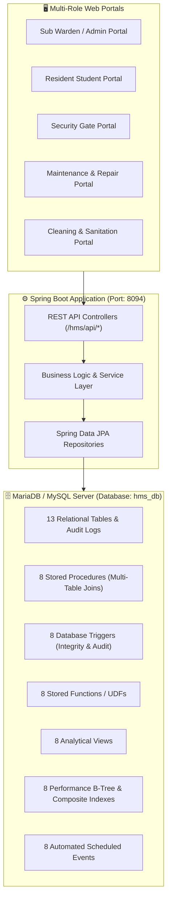

# 🏢 University of Ruhuna - Hostel Management System (HMS)
### Advanced Database Management Systems (ADBMS) — Mini Project


---

## 📌 Project Overview
The **Hostel Management System (HMS)** is an enterprise-grade university residential management platform developed for the **University of Ruhuna**. It streamlines student room allocations, gate clearance passes, hostel fee invoicing, inventory and asset repair workflows, student complaints, and multi-department staff shift attendance.

The project highlights advanced relational database engineering principles including **48 Advanced Database Objects** distributed evenly across two group members (**24 components per member**).

---

## 🏗️ System Architecture & Workflow



---

## 👥 ADBMS Workload Distribution Matrix (2 Members)

| Component Category | Member 1 (Student Welfare & Residence) | Member 2 (Treasury & Logistics) | Total Objects |
| :--- | :---: | :---: | :---: |
| **Stored Procedures** | **4** *(Multi-table operations 3–5 tables)* | **4** *(Multi-table operations 3–4 tables)* | **8** |
| **Database Triggers** | **4** *(Occupancy, Pass Dates, Capacity, Complaints)* | **4** *(Audit, Amount Validation, Stock, Checkout)* | **8** |
| **Stored Functions (UDFs)** | **4** *(Occupancy %, Complaints Count, Pass Status, Block)* | **4** *(Revenue, Available Stock, Staff Attendance, Arrears)* | **8** |
| **Analytical Views** | **4** *(Student Details, Gate Passes, Complaints, Occupancy)* | **4** *(Revenue Summary, Inventory Health, Damages, Staff)* | **8** |
| **Performance Indexes** | **4** *(Student ID, Room Role, Gate Pass Status, Complaints)* | **4** *(Month Status, User Date, Category Stock, Staff Attendance)* | **8** |
| **Scheduled Events** | **4** *(Pass Expiry, Daily Snapshot, Overdue Flag, Escalation)* | **4** *(Fee Notice, Absence Marker, Restock Alert, Log Purge)* | **8** |
| **Total Advanced Objects** | **24 Objects** | **24 Objects** | **48 Objects** |

---

## 👤 Member 1: Detailed Contributions
**Script File:** [`src/main/resources/adbms_member1_student_welfare.sql`](src/main/resources/adbms_member1_student_welfare.sql)  
**Domain:** Student Welfare, Room Allocation, Gate Pass Security, and Complaints.

### 1. Stored Procedures (4)
1. `sp_AllocateStudentRoom(p_student_id, p_room_number, OUT p_status)` — Safely allocates a student to a room across 5 tables (`users`, `rooms`, `payments`, `room_inventory`, `user_audit_log`).
2. `sp_DeallocateStudentRoom(p_student_id, OUT p_status)` — Room checkout procedure verifying damage/complaint clearances across 4 tables.
3. `sp_ProcessGatePassApproval(p_pass_id, p_decision, p_reviewer, OUT p_result)` — Three-table join workflow updating pass decision and logging audit history.
4. `sp_FileStudentComplaint(p_student_id, p_room_number, p_item, p_description, OUT p_complaint_id)` — Complaint filing routine cross-referencing warehouse inventory availability.

### 2. Database Triggers (4)
1. `trg_AfterUserRoomChange` (`AFTER UPDATE ON users`) — Synchronizes `rooms.current_occupancy` counter on room changes.
2. `trg_BeforeGatePassInsert` (`BEFORE INSERT ON gate_passes`) — Validates `to_date >= from_date` using custom `SIGNAL SQLSTATE '45000'`.
3. `trg_PreventExceedRoomCapacity` (`BEFORE UPDATE ON rooms`) — Prevents overbooking beyond maximum bed capacity.
4. `trg_AfterComplaintResolvedLog` (`AFTER UPDATE ON complaints`) — Automatically records resolution audit logs in `user_audit_log`.

### 3. Stored Functions / UDFs (4)
1. `fn_GetRoomOccupancyRate(p_room_id)` — Returns occupancy percentage (`DECIMAL(5,2)`) by joining rooms and users.
2. `fn_GetStudentTotalComplaints(p_user_id)` — Returns count of complaints filed by student.
3. `fn_CheckStudentGatePassStatus(p_user_id)` — Returns real-time status (`ON_OFFICIAL_LEAVE`, `OVERDUE_RETURN`, `IN_HOSTEL`).
4. `fn_GetRoomBlockFloor(p_room_number)` — Parses block name and floor level from room number string.

### 4. Analytical Views (4)
1. `vw_StudentRoomDetails` — 360° overview joining users, rooms, payments, and complaints.
2. `vw_ActiveGatePasses` — Security gate clearance dashboard joining gate passes, users, and rooms.
3. `vw_PendingComplaintsDashboard` — Maintenance dashboard cross-referencing open tickets with warehouse spare parts.
4. `vw_RoomOccupancyOverview` — Hostel block capacity, vacant beds, broken equipment, and occupancy percentage.

### 5. Performance Indexes (4)
1. `idx_users_student_id` on `users(student_id)` — Speeds up student logins and TG registration lookup.
2. `idx_users_room_role` on `users(room_id, role)` — Accelerates roommate listings and block population queries.
3. `idx_gate_passes_user_status` on `gate_passes(user_id, status)` — Speeds up student pass history and status checks.
4. `idx_complaints_status_room` on `complaints(status, room_number)` — Accelerates ticket filtering by room number.

### 6. Scheduled Events (4)
1. `evt_AutoExpireOldGatePasses` — Daily event marking pending passes as `EXPIRED` if departure date has passed.
2. `evt_DailyRoomOccupancySnapshot` — Daily event at 23:59 recording room occupancy statistics into `hostel_daily_stats`.
3. `evt_FlagOverdueResidents` — Runs every 6 hours to mark approved passes as `OVERDUE_RETURN` if student has not returned.
4. `evt_AutoEscalatePendingComplaints` — Daily event escalating complaints unreviewed for more than 4 days.

---

## 👤 Member 2: Detailed Contributions
**Script File:** [`src/main/resources/adbms_member2_treasury_logistics.sql`](src/main/resources/adbms_member2_treasury_logistics.sql)  
**Domain:** Treasury, Invoicing, Warehouse Inventory, Asset Repairs, and Staff Attendance.

### 1. Stored Procedures (4)
1. `sp_RecordStudentPayment(p_student_id, p_month, p_amount, OUT p_invoice_no)` — Atomic fee settlement and receipt generation across 4 tables.
2. `sp_ReportRoomDamage(p_room_number, p_item_name, p_broken_qty, p_description, OUT p_damage_id)` — Logs broken asset, updates stock, and links student tickets.
3. `sp_CompleteRoomRepair(p_damage_id, OUT p_status)` — Restores spare stock in warehouse and auto-resolves corresponding complaints.
4. `sp_RecordStaffCheckIn(p_staff_id, p_marked_by, OUT p_status)` — Registers staff daily check-in with department role validation.

### 2. Database Triggers (4)
1. `trg_AfterPaymentInsertAudit` (`AFTER INSERT ON payments`) — Logs financial audit records with student ID into `payment_audit_log`.
2. `trg_BeforePaymentValidateAmount` (`BEFORE INSERT ON payments`) — Rejects non-positive payments (`amount <= 0`) with `SQLSTATE '45000'`.
3. `trg_BeforeInventoryStockUpdate` (`BEFORE UPDATE ON inventory`) — Maintains mathematical consistency between total, available, and broken stock.
4. `trg_BeforeStaffCheckOutUpdate` (`BEFORE UPDATE ON staff_attendance`) — Automatically populates default remarks upon shift checkout.

### 3. Stored Functions / UDFs (4)
1. `fn_CalculateMonthlyTotalRevenue(p_month)` — Computes total verified fee revenue for a given month.
2. `fn_GetItemAvailableStock(p_item_id)` — Calculates true available warehouse stock subtracting broken room assets.
3. `fn_GetStaffMonthlyPresentDays(p_user_id, p_year, p_month)` — Computes total days present in a month for staff payroll audit.
4. `fn_CalculateStudentFeeArrears(p_user_id)` — Computes outstanding hostel fee arrears (Expected fee minus total paid).

### 4. Analytical Views (4)
1. `vw_MonthlyRevenueSummary` — Monthly revenue, paid invoices count, pending count, and average fee collected.
2. `vw_InventoryHealthStatus` — Warehouse stock levels, broken item counts in rooms, and stockout condition indicators.
3. `vw_RoomDamagesTracker` — Active equipment damages linked to room location, resident students, and spare stock.
4. `vw_StaffDutyAttendanceSummary` — Staff supervisor dashboard showing total shifts, attendance percentage, and last duty date.

### 5. Performance Indexes (4)
1. `idx_payments_month_status` on `payments(month, status)` — Accelerates monthly revenue and fee collection reports.
2. `idx_payments_user_date` on `payments(user_id, payment_date)` — Speeds up student fee history lookups and statement generation.
3. `idx_inventory_category_avail` on `inventory(category, available_quantity)` — Accelerates warehouse stock category filtering.
4. `idx_staff_att_user_date` on `staff_attendance(user_id, date, status)` — Speeds up staff duty roster audits and daily shift verification.

### 6. Scheduled Events (4)
1. `evt_MonthlyFeeBillingReminder` — Monthly event on 1st posting official boarding fee notice to resident students.
2. `evt_DailyStaffAbsenceMarker` — Daily event at 18:30 marking absent records for staff who failed to clock in.
3. `evt_WeeklyInventoryRestockAlert` — Weekly event scanning warehouse inventory and logging alerts for items with `< 5` units.
4. `evt_PurgeOldAuditLogs` — Monthly housekeeping event purging payment and user audit logs older than 180 days.

---

## ⚡ Dedicated Triggers & Indexes Script
For easy verification, project evaluation, or instant execution in phpMyAdmin / MySQL CLI, both members' triggers and indexes are unified in:
👉 [`src/main/resources/adbms_triggers_and_indexes.sql`](src/main/resources/adbms_triggers_and_indexes.sql)

To verify all triggers and indexes in phpMyAdmin SQL tab:
```sql
-- View all 8 Database Triggers:
SHOW TRIGGERS;

-- View all 8 Performance Indexes:
SELECT TABLE_NAME, INDEX_NAME, GROUP_CONCAT(COLUMN_NAME) AS COLUMNS
FROM information_schema.STATISTICS 
WHERE TABLE_SCHEMA = 'hms_db' AND INDEX_NAME LIKE 'idx_%'
GROUP BY TABLE_NAME, INDEX_NAME;
```

---

## 🔒 Database Transactions & ACID Compliance (8 Stored Procedures)
All 8 Stored Procedures are engineered with full **ACID Transaction Control**:
1. **Atomicity (All-or-Nothing):** Multi-table updates are wrapped in `START TRANSACTION; ... COMMIT;`.
2. **Error Recovery (Rollback):** Every procedure contains an explicit `DECLARE EXIT HANDLER FOR SQLEXCEPTION` that triggers `ROLLBACK;` automatically if an error or constraint violation occurs.
3. **Application Layer:** Spring Boot services (`PaymentServiceImpl`, `UserServiceImpl`, `RoomInventoryServiceImpl`, `ComplaintServiceImpl`, `GatePassServiceImpl`, `StaffAttendanceServiceImpl`) are annotated with `@Transactional`.

Dedicated standalone transactions script:  
👉 [`src/main/resources/adbms_transactions_and_stored_procedures.sql`](src/main/resources/adbms_transactions_and_stored_procedures.sql)

### Quick Verification in MySQL / phpMyAdmin:
```sql
-- 1. Test Payment Transaction (Atomically creates payment + audit record)
CALL sp_RecordStudentPayment('TG/2021/0001', 'December 2026', 1500.00, @inv);
SELECT @inv AS generated_invoice;
SELECT * FROM payment_audit_log ORDER BY id DESC LIMIT 1;

-- 2. Test Room Allocation Transaction (Atomically updates users, rooms, and audit log)
CALL sp_AllocateStudentRoom('TG/2021/0001', 'A-102', @alloc_status);
SELECT @alloc_status AS allocation_status;
SELECT * FROM user_audit_log ORDER BY id DESC LIMIT 1;
```

---

## 🚀 Setup & Execution Guide

### 1. Prerequisites
- **Java Development Kit (JDK):** Version 17 or higher
- **Database Server:** MariaDB 10.4+ or MySQL 8.0+ (e.g. through XAMPP)
- **Port Availability:** Port `3306` (Database) and Port `8094` (Application)

### 2. Database Initialization
1. Start **Apache** and **MySQL** services in the XAMPP Control Panel.
2. Open phpMyAdmin at `http://localhost/phpmyadmin`.
3. Create a new database named `hms_db`.
4. Import the following SQL scripts in order:
   - `src/main/resources/adbms_member1_student_welfare.sql`
   - `src/main/resources/adbms_member2_treasury_logistics.sql`
   - *(Optional standalone script: `src/main/resources/adbms_triggers_and_indexes.sql`)*

### 3. Application Configuration
Verify the database connection in [`src/main/resources/application.properties`](src/main/resources/application.properties):
```properties
server.port=8094
server.servlet.context-path=/hms
spring.datasource.url=jdbc:mysql://localhost:3306/hms_db?createDatabaseIfNotExist=true&useSSL=false&serverTimezone=UTC
spring.datasource.username=root
spring.datasource.password=
```

### 4. Running the Application
Using PowerShell / Terminal in the project root:
```bash
# Build and run using Gradle Wrapper
./gradlew bootRun
```
Once started, access the application in your browser:
👉 **`http://localhost:8094/hms/login.html`**

---

## 🔑 Default Login Credentials

| Role | Username / ID | Password | Portal Features |
| :--- | :--- | :--- | :--- |
| **Sub Warden (Admin)** | `admin` | `admin123` | Full administrative control, users, rooms, treasury, complaints, passes, staff roster, notices |
| **Resident Student** | `TG/2021/0001` | `password` | Room allocation view, fee payment statements, gate pass applications, complaint filing |
| **Security Officer** | `SEC001` | `password` | Real-time gate clearances, student departure/arrival scanning, shift check-in |
| **Maintenance Staff** | `MAINT001` | `password` | Facility repairs, room damaged equipment restoration, ticket resolution |
| **Cleaning Staff** | `CLEAN001` | `password` | Room sanitation tracking, housekeeping overview, shift check-in |

---

## 🛠️ Technology Stack
- **Backend:** Java 17, Spring Boot 3, Spring Data JPA, Hibernate, JavaMailSender
- **Database:** MariaDB 10.4 / MySQL Server (Stored Procedures, Triggers, Functions, Views, Indexes, Events)
- **Frontend:** Responsive HTML5, Vanilla CSS3 (Custom Design System, Dark Mode accents, Glassmorphism), Vanilla JavaScript ES6
- **Visualization:** Chart.js, Font Awesome 6, Google Fonts (Outfit, Inter, Poppins)
- **Build Tool:** Gradle Wrapper

---

## 📜 Academic Integrity & License
This project is submitted in partial fulfillment of the requirements for the **Advanced Database Management Systems (ADBMS)** course at the **Faculty of Technology, University of Ruhuna**.
